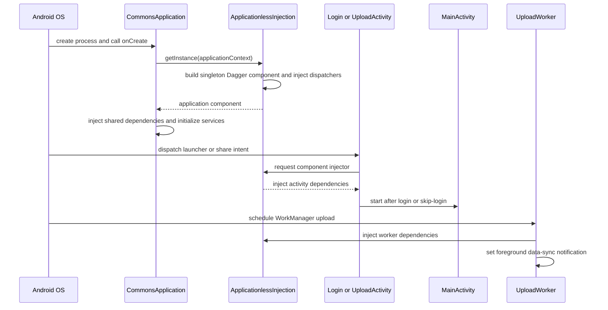

# Application runtime and dependency graph

## Process startup and entrypoints

Android declares `CommonsApplication` as the application class. The exported `LoginActivity` owns the `MAIN` and `LAUNCHER` intent filter, so a normal cold start enters the authentication screen. `UploadActivity` is a second exported entrypoint: it accepts both `ACTION_SEND` and `ACTION_SEND_MULTIPLE` for `image/*` and `audio/ogg`, and uses `singleTask` launch behavior so an existing upload task can receive another share. `MainActivity` is the primary in-app host but has no launcher or share filter and is reached from login or the persisted skip-login path. These exported activities are the trust boundary for external intents; changes to their filters or input handling should be reviewed as public API changes. [AndroidManifest.xml](../../app/src/main/AndroidManifest.xml#L47-L124)

The manifest also exposes `WikiAccountAuthenticatorService` for Android account integration in the `:auth` process. ACRA's crash dialog and sender run in the separate `:acra` process. Upload execution is WorkManager-backed: the manifest declares `SystemForegroundService` with `dataSync`, and the worker promotes itself to foreground execution with a data-sync `ForegroundInfo`. The file provider and feature content providers are explicitly non-exported, while the app widget and download receiver are exported for their platform callbacks. [AndroidManifest.xml](../../app/src/main/AndroidManifest.xml#L71-L79) [AndroidManifest.xml](../../app/src/main/AndroidManifest.xml#L190-L269) [UploadWorker.kt](../../app/src/main/java/fr/free/nrw/commons/upload/worker/UploadWorker.kt#L179-L185)

This sequence shows the process startup, external entrypoints, and the two injection paths used by UI and upload work.

## Application initialization and failure behavior

`CommonsApplication.onCreate()` performs initialization in a deliberate order:

1. It stores the process singleton and initializes ACRA before resolving application dependencies. ACRA is configured to collect version, Android, device, user comment, and stack-trace fields and to offer a report dialog/mail sender.
2. `ApplicationlessInjection.getInstance(this)` lazily constructs the Dagger component, injects its dispatching injectors, and injects `CommonsApplication` itself. This is a process-wide cached graph, not a new graph per activity.
3. Timber plants a file tree and a debug tree. The file tree uses a low-priority single-thread pool; stale log archives larger than the configured threshold are deleted, while cleanup errors are logged rather than allowed to abort startup.
4. It applies the default managed EXIF location tag unless the user explicitly removed location handling, configures Fresco with the app's `CustomOkHttpNetworkFetcher` and downsampling, creates the notification channel, and loads the language lookup table.
5. It installs an RxJava global error handler that consumes errors from disposed or missing-error-handler observables and sets the upload progress threshold system property to `3.0`.

Fresco initialization is the notable soft failure: it is wrapped in `try/catch`, logged with Timber, and allowed to continue. The comment explicitly records that this is needed because Fresco cannot yet initialize reliably in test builds; unit tests therefore initialize Fresco themselves where required. This exception should not be generalized to the Dagger graph or ACRA: failure before injection completes can prevent the application from starting. [CommonsApplication.kt](../../app/src/main/java/fr/free/nrw/commons/CommonsApplication.kt#L101-L150) [CommonsApplication.kt](../../app/src/main/java/fr/free/nrw/commons/CommonsApplication.kt#L152-L204) [GridViewAdapterUnitTest.kt](../../app/src/test/kotlin/fr/free/nrw/commons/category/GridViewAdapterUnitTest.kt#L45-L58)

## Dagger ownership and injection boundaries

`CommonsApplicationComponent` is a `@Singleton` component. It combines application and networking modules with Android's injection modules plus activity, fragment, service, provider, upload, contribution, search, depiction, and category modules. `ApplicationlessInjection` builds it with `CommonsApplicationModule(applicationContext)`, injects its dispatcher fields once, and exposes dispatchers for activities, both fragment APIs, services, broadcast receivers, content providers, and arbitrary Android objects. The component also has explicit injection methods for the application, `LoginActivity`, selected framework objects, `UploadWorker`, and `FileProcessor`. [ApplicationlessInjection.kt](../../app/src/main/java/fr/free/nrw/commons/di/ApplicationlessInjection.kt#L25-L65) [ApplicationlessInjection.kt](../../app/src/main/java/fr/free/nrw/commons/di/ApplicationlessInjection.kt#L67-L95) [CommonsApplicationComponent.kt](../../app/src/main/java/fr/free/nrw/commons/di/CommonsApplicationComponent.kt#L27-L84)

Activities are contributed through `ActivityBuilderModule`; it contains bindings for the launcher, main, upload, progress, authentication, and feature activities. A new injectable activity must be added there or Dagger cannot dispatch its injection. The service module currently contributes the account authenticator service. Upload work is a separate extension point: `UploadWorker` performs explicit component injection in its constructor, and its own nested module contributes it to Android injection. This means adding an injected service, worker, provider, or activity requires updating the corresponding builder module as well as the manifest or scheduler boundary. [ActivityBuilderModule.kt](../../app/src/main/java/fr/free/nrw/commons/di/ActivityBuilderModule.kt#L28-L101) [ServiceBuilderModule.kt](../../app/src/main/java/fr/free/nrw/commons/di/ServiceBuilderModule.kt#L7-L16) [UploadWorker.kt](../../app/src/main/java/fr/free/nrw/commons/upload/worker/UploadWorker.kt#L54-L118)

`BaseActivity` is a shared lifecycle policy for most screens: it injects preferences and theme utilities, applies the device font scale and edge-to-edge rendering, recreates on a runtime dark-mode change, and clears activity-scoped Rx disposables in `onDestroy`. `LoginActivity` is an account-authenticator activity with its own delegate setup, but it still obtains component injection explicitly in `onCreate`; do not assume every activity has identical lifecycle plumbing. [BaseActivity.kt](../../app/src/main/java/fr/free/nrw/commons/theme/BaseActivity.kt#L17-L67) [LoginActivity.kt](../../app/src/main/java/fr/free/nrw/commons/auth/LoginActivity.kt#L49-L82)

## Login and navigation ownership

`LoginActivity` injects `SessionManager`, preferences, `LoginClient`, and theme utilities. On resume, an already authenticated session clears `login_skipped` and starts `MainActivity`; a persisted skip flag instead completes the skip-login path. Logout is application-owned: it cancels unique upload work, resets the worker stop marker, clears account and cookie state, clears caches and preferences, refreshes local tables, and then launches `LoginActivity` with optional message and username extras while clearing the old task. [LoginActivity.kt](../../app/src/main/java/fr/free/nrw/commons/auth/LoginActivity.kt#L49-L82) [LoginActivity.kt](../../app/src/main/java/fr/free/nrw/commons/auth/LoginActivity.kt#L171-L182) [CommonsApplication.kt](../../app/src/main/java/fr/free/nrw/commons/CommonsApplication.kt#L218-L257) [CommonsApplication.kt](../../app/src/main/java/fr/free/nrw/commons/CommonsApplication.kt#L340-L355)

`MainActivity` owns the top-level fragment navigation and the persisted navigation hints. If `login_skipped` is true it opens Explore and installs the restricted `NavTabLoggedOut` pager. Otherwise it initializes first-run flags, restores Nearby when `last_opened_nearby` is set (or starts Contributions), installs the signed-in pager, and checks for stuck uploads. Signed-in tabs are Contributions, Nearby, Explore, and Bookmarks; selecting More opens a logged-in or logged-out bottom sheet based on the same preference. Back handling remains in `MainActivity`, which delegates to the active fragment and returns to Contributions when appropriate. [MainActivity.kt](../../app/src/main/java/fr/free/nrw/commons/contributions/MainActivity.kt#L113-L208) [MainActivity.kt](../../app/src/main/java/fr/free/nrw/commons/contributions/MainActivity.kt#L214-L305)

## Background upload lifecycle and operational checks

The upload worker injects the session, upload and media clients, contribution/status DAOs, file utilities, and places repository before work begins. `doWork()` calls `setForeground()` first, processes queued contributions on `Dispatchers.IO`, persists progress and notifications, retries if new queued contributions appear, returns failure after logging an exception, and always clears the shared “worker stopped” marker in `finally`. The manifest's `FOREGROUND_SERVICE` and `FOREGROUND_SERVICE_DATA_SYNC` permissions must remain aligned with this path, and notification permission/channel behavior matters on modern Android. [AndroidManifest.xml](../../app/src/main/AndroidManifest.xml#L21-L30) [UploadWorker.kt](../../app/src/main/java/fr/free/nrw/commons/upload/worker/UploadWorker.kt#L179-L269) [UploadWorker.kt](../../app/src/main/java/fr/free/nrw/commons/upload/worker/UploadWorker.kt#L271-L297)

When diagnosing startup or upload issues, inspect ACRA reports and Timber's file/debug output, then verify the manifest process and exported-component declarations before changing dependency wiring. For changes to initialization, test both a normal application process and the test build: Fresco's guarded initialization is an intentional compatibility exception, whereas missing Dagger bindings, missing notification setup, or an unhandled worker failure changes observable runtime behavior.

## Related architecture and workflows

- [Networking and local storage](networking-and-storage.md) describes the API clients and database ownership supplied to this graph.
- [Account and authentication flow](../workflows/account-and-authentication.md) follows login results into persisted account state.
- [Media upload lifecycle](../workflows/media-upload.md) traces share and in-app upload requests through WorkManager.
- [Release and diagnostics](../operations/release-and-diagnostics.md) is the operational companion for crash reports and logs.
