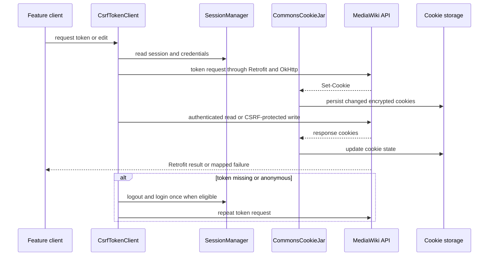
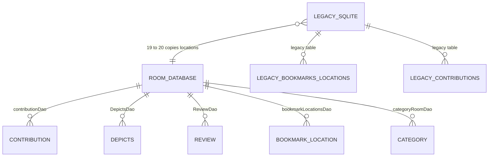

# Networking and local storage

The app has two closely related service paths. Retrofit services created by `CommonsServiceFactory` use the shared `OkHttpClient` from `OkHttpConnectionFactory`; direct endpoints such as Toolforge and SPARQL are consumed by `OkHttpJsonApiClient` through the separately provided `OkHttpClient`. Dagger supplies these clients, service interfaces, CSRF clients, cookie storage, and DAOs as application-scoped objects. The factory caches one Retrofit instance per base URL, so Commons and Wikidata share transport configuration while retaining distinct API interfaces.

## HTTP client policy

`OkHttpConnectionFactory` configures the client used by the Retrofit factory with:

- 120-second connect, write, and read timeouts;
- a 64 MiB disk cache at the application cache directory under `okhttp-cache` when an application context exists;
- a common `User-Agent` interceptor;
- BASIC HTTP logging, with `Authorization` and `Cookie` headers redacted; and
- an `UnsuccessfulResponseInterceptor` that removes the internal `x-commons-suppress-error-log` header before sending the request.

The Dagger-provided direct `OkHttpClient` also uses 120-second connect, write, and read timeouts and a disk cache (`okHttpCache`). Its logging level is BODY in debug builds and BASIC otherwise. This is a transport cache, not an application data cache, and the code does not promise a particular cache hit policy or network freshness policy.

For normal requests, a non-2xx response becomes `IOException("Unsuccessful response")`. A nominally successful response whose body begins with the MediaWiki JSON error prefix is parsed as `MwErrorResponse` and becomes `MwIOException`. The upload API URL is explicitly excluded from that JSON-error interception so upload callers can handle its response themselves. A caller may use `SUPPRESS_ERROR_LOG_HEADER`: it is consumed locally, and a recognized MediaWiki error is logged at DEBUG rather than ERROR and is not rethrown by the interceptor. These mechanisms do not establish automatic HTTP retries.

Logging is deliberately different by build and failure type: OkHttp traffic is verbose in debug builds, while the shared factory is BASIC and redacts credentials; ordinary failures are logged through Timber at ERROR unless suppressed. Higher-level clients sometimes translate failures into domain results. For example, `PageEditClient` returns `false` for ordinary edit failures but rethrows `InvalidLoginTokenException`, while `OkHttpJsonApiClient` methods may return an empty result, `0`, or `null` after a failed direct request. Consumers must therefore follow the particular client contract rather than assume every network failure propagates as an exception.

## Retrofit services and MediaWiki APIs

`CommonsServiceFactory` lazily builds Retrofit with the shared OkHttp client, `RxJava2CallAdapterFactory`, and the singleton `GsonUtil.defaultGson`. Its `retrofitCache` is keyed by base URL; `create(BuildConfig.COMMONS_URL)` and `create(BuildConfig.WIKIDATA_URL)` therefore reuse the corresponding Retrofit object. Dagger binds those generated interfaces to purpose-specific clients: login, logout, CSRF, page editing, uploads, media, reviews, depictions, and WikiBase operations. `OkHttpJsonApiClient` covers non-Retrofit JSON endpoints and executes blocking calls on `Dispatchers.IO` where its suspend methods require it. Rx consumers are given an injected `Schedulers.io()` scheduler and Android main-thread scheduler rather than doing blocking work on the UI thread.

### Cookies and session continuity

`CommonsCookieStorage` keeps cookies grouped by domain in the `default_preferences` `JsonKvStore` under `cookie_store`. Dagger loads it once before constructing the singleton `CommonsCookieJar`. Saves serialize cookies with Gson and encrypt the JSON with `CryptoUtils`; data loaded from an older unencrypted representation is re-saved encrypted when possible. Cookie replacement is name-based, deletion and expiry remove entries, and storage is written only when the jar changes. `clear()` removes all persisted cookies.

`CommonsCookieJar` supplies cookies whose stored domain matches the request authority. For hosts outside the Wikipedia domain it also forwards only `centralauth_` cookies from `commons.wikimedia.org`, allowing the shared login state to travel to related Wikimedia sites without forwarding every Commons cookie. Expired cookies are pruned while loading a request. This persistence is separate from the HTTP response cache.

### CSRF-protected writes

There are named CSRF clients for Commons and Wikidata. Before an edit, `PageEditClient` obtains a token and passes it to the relevant MediaWiki edit method. The blocking path executes token acquisition on a newly created single-thread executor, and makes at most two login attempts (`MAX_RETRIES_OF_LOGIN_BLOCKING`): the first uses the current session, and a later attempt explicitly logs in with the stored credentials. An empty token or an anonymous token while the session says the user is logged in produces `InvalidLoginTokenException`.

The asynchronous path requests the token with Retrofit callbacks. On failure, or on an anonymous token for a logged-in session, it can perform one logout/login recovery (`MAX_RETRIES = 1`) when credentials are available, then cancels the old calls and requests a fresh token. It exposes two-factor and email-auth prompts through its callback. This is targeted session recovery, not a general retry guarantee for arbitrary HTTP requests.

*Representative authenticated read and write flow, including cookie persistence and targeted CSRF recovery.*

## Persistence boundary: Room and legacy SQLite

Room is the current application database. `AppDatabase` is version 22 and exposes DAOs for contributions, depicts and upload status, reviews, places, bookmark categories and locations, categories, bookmark pictures/items, recent languages, and recent searches. `CommonsApplicationModule` builds the singleton as `commons_room.db`, registers migrations `1→2`, `19→20`, and `21→22`, and uses `fallbackToDestructiveMigration()` for versions without a registered migration. The module also provides the individual DAOs, so feature code depends on DAO interfaces rather than opening the database itself.

The older `DBOpenHelper` remains a separate `commons.db` boundary used by legacy content providers. It creates and upgrades legacy category, bookmark, bookmark-item, recent-search, and recent-language tables. Its upgrade callback delegates table-specific upgrades and then drops and recreates the legacy `contributions` and `bookmarksLocations` tables; the helper catches `SQLiteException` while dropping/recreating a table. It is injected into content providers by `CommonsDaggerContentProvider`, which exposes the writable `SupportSQLiteDatabase` to those providers.

The important bridge is Room migration `19→20`: it creates Room’s `bookmarks_locations` table, opens the old `commons.db` read-only, reads `bookmarksLocations`, and inserts the location values into Room. This is a one-way migration boundary; the current Room database does not use the legacy helper as its backing store. The Room builder’s destructive fallback means an unrecognised schema jump can discard local Room data, so new schema versions should add a deliberate migration when data preservation matters.

*Persistence boundary: Room owns current entities and DAOs; the legacy database is read during the explicit bookmark-location migration.*

Room entities are not all foreign-key-linked in the source model. In particular, `Contribution` embeds media fields and stores depicted items through its Room representation, while `Depicts` is independently keyed by a depicted item. The diagram therefore describes DAO ownership and the migration relationship, not an inferred relational foreign-key graph.

## Threading and operational guidance

Network calls that use Retrofit’s asynchronous or Rx adapters should remain asynchronous; blocking token acquisition and direct OkHttp calls must be scheduled away from the main thread. The dependency graph exposes `Schedulers.io()` and `AndroidSchedulers.mainThread()` for this handoff. The OkHttp factory singleton is replaceable in tests through its `@VisibleForTesting CLIENT` property, and the MockWebServer test base installs a test client and immediate dispatcher. Database tests use an in-memory Room database and exercise table/DAO behavior directly. These seams are the focused places to test timeout/error mapping, cookie persistence, CSRF recovery, Retrofit base-URL caching, migrations, and DAO behavior without depending on live Wikimedia services.

For changes, preserve the separation between (1) shared authenticated Retrofit traffic, (2) direct JSON endpoints with their own response mapping, (3) encrypted cookie state, (4) Room DAOs, and (5) legacy content-provider storage. A change to one layer does not imply retries, cache invalidation, or error propagation in the others.
