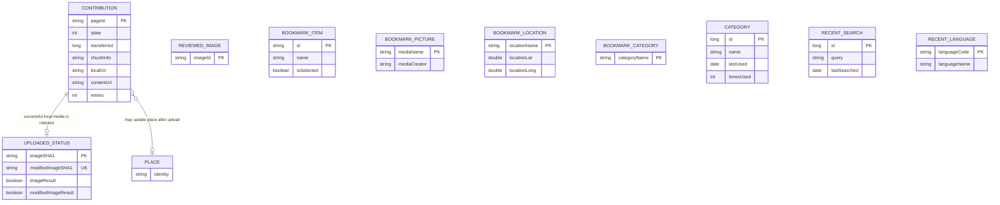
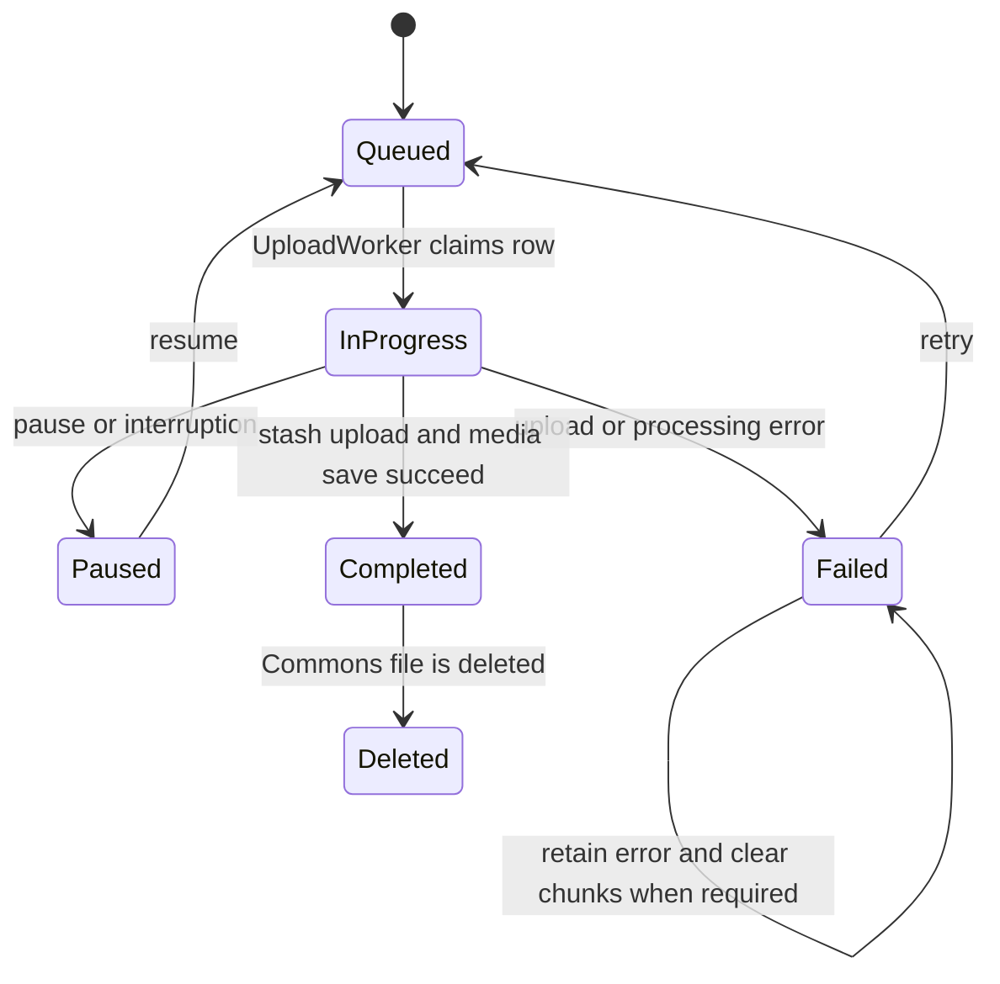

# Domain data, persistence, and lifecycle state

The app has three deliberately different kinds of state:

- **Room durable records** are queryable application data: the contribution queue, uploaded-image fingerprints, reviews, places, bookmarks, categories, recent searches, and recent languages. `AppDatabase` is the registry and exposes a DAO for each family.
- **Key-value preferences** are small settings or cached objects owned by a `BasicKvStore`/`JsonKvStore`. They are not substitutes for relational records or queue state.
- **Transient models** cross screens and workers, commonly as `Parcelable` values. `UploadResult` is an upload response; `ChunkInfo` is resumable-upload progress; neither is a separate Room table. A `Contribution` embeds or converts these values when progress must survive process death.

## Durable storage map

`AppDatabase` is a Room database at schema version 22. Its entities include `Contribution`, `Depicts`, `UploadedStatus`, `NotForUploadStatus`, `ReviewEntity`, `Place`, bookmark categories, locations, pictures and items, `CategoryRoomEntity`, `RecentLanguageRoomEntity`, and `RecentSearchRoomEntity`. `Converters` serialize dates, URIs, lists/maps, places, depictions, and chunk information for Room columns.

This diagram shows durable records and the two meaningful cross-record relationships; most tables are intentionally independent caches or user-history collections rather than a normalized foreign-key graph. The `Contribution` to `UploadedStatus` relationship is operational rather than a Room foreign key: a successful upload writes fingerprint status separately, keyed by original and modified SHA-1 values.

### Room records and ownership

- **Contributions and queue records:** `Contribution` is keyed by `pageId` (normally the media page identity) and embeds `Media`. It carries upload metadata such as local/content URIs, MIME type, SHA-1, dates, location and Wikidata place, retry count, error text, byte transfer count, and `ChunkInfo`. `ContributionDao` supports replacement saves, updates, deletion by state, state-wide transitions, pending counts, and paged queries. Its save/update wrappers also maintain modification and upload-start timestamps.
- **Uploaded and excluded media:** `UploadedStatus` uses the original image SHA-1 as its primary key and enforces uniqueness of `modifiedImageSHA1`. It stores both API query results and a validation timestamp. `UploadedStatusDao` can query either fingerprint and count matching result flags. Upload success writes a row with whether original and modified hashes match. `NotForUploadStatus` serves the complementary custom-selector exclusion path and is registered in the same database.
- **Review history:** `ReviewEntity` stores one `imageId` in `reviewed-images`; `ReviewDao` inserts with `IGNORE` conflict behavior and answers whether an image has already been reviewed or skipped. This is a set, not a review-content record.
- **Bookmarks:** bookmark categories, locations, pictures, and items are separate Room entities and DAO families. Categories are keyed by category name; locations are keyed by location name and preserve display metadata, coordinates, links, picture and existence; pictures are keyed by media name; items are keyed by item id and retain descriptions, image URL, instance/category data, and selection state. These records are local bookmark/cache representations, not `Contribution` records.
- **Reusable discovery data:** `CategoryRoomEntity` tracks category metadata plus `lastUsed` and `timesUsed`. `RecentSearchRoomEntity` tracks a query and its last-search date. `RecentLanguageRoomEntity` is keyed by language code and stores the display name. They are histories and suggestions, not global user preferences.
- **Places:** `Place` is registered as a Room entity and has a `PlaceDao`; bookmark locations can be converted to and from `Place`. A selected Wikidata place may also be serialized inside a contribution and used after upload for a Wikidata image claim.

The database boundary is DAO-based: callers should use the relevant DAO rather than reaching into SQLite. Schema changes must update the Room database version and migration strategy; the current declaration is version 22, with schema export disabled.

## Preferences and serialized objects

`BasicKvStore` wraps a named Android `SharedPreferences` store. Its optional integer version is stored under the reserved `__version__` key; downgrades are rejected, upgrades invoke the update hook, and `clearAllOnUpgrade` can clear user keys while preserving the version. Public puts and removes reject use of the reserved key. This is appropriate for preference-like values and small application-scoped cached objects, not for records needing queries, conflict handling, or independent lifecycle.

`JsonKvStore` adds Gson `putJson` and typed `getJson`; malformed JSON returns `null` rather than escaping as a `JsonSyntaxException`. Callers must therefore handle a missing or invalid cached object. A JSON value such as a selected `Place` remains a preference/cache object even if the same domain type is also persisted through Room elsewhere.

## Contribution and upload lifecycle

The integer state on `Contribution` is the queue's source of truth:

- `STATE_QUEUED = 2`: eligible for the worker.
- `STATE_IN_PROGRESS = 3`: currently claimed/being processed; the worker avoids starting another in-progress upload.
- `STATE_PAUSED = 4`: deliberately stopped and eligible for a later resume.
- `STATE_FAILED = 1`: upload or processing failed; `errorInfo` and retry count provide diagnostics.
- `STATE_COMPLETED = -1`: the server-side media record has been fetched and saved as the completed contribution.
- `STATE_DELETED = 5`: Commons deleted the file; the row remains so the UI can distinguish deletion from an ordinary upload.

The lifecycle is persisted, so process death recovery can find rows left `IN_PROGRESS` and re-queue them through the contribution/app startup recovery path. The worker initially processes queued rows, orders them by upload-start time, marks the selected row in progress, and writes progress back to Room. Pausing changes queued/in-progress rows to paused; retry changes failed rows back to queued. A failed stash or upload can clear `chunkInfo`, while some failure handling retains it until the failure-specific cleanup path decides it is unsafe to resume.

### Resumable progress invariants

`ChunkInfo` contains the last `UploadResult`, `indexOfNextChunkToUpload`, and `totalChunks`. `UploadResult` carries the stash result string, file key, server offset, and filename; only the exact `"Success"` result is successful, and its canonical title is `File:` plus the filename. After each uploaded chunk, the worker stores `ChunkInfo`; byte progress is stored separately in `Contribution.transferred` and updates notifications. `Contribution.isCompleted()` is true only when chunk information exists and the next-chunk index equals total chunks. Do not infer completion solely from the UI state or from `transferred`.

On successful completion, the worker may perform the Wikidata place edit, fetch the uploaded media, replace the queue row transactionally (`deleteAndSaveContribution`), mark the contribution completed, and write `UploadedStatus` fingerprints. The uploaded-status write is intentionally separate and asynchronous; it is a selector cache, not the transaction that defines contribution completion. Persistable content-URI permission is released after the successful upload path.

## Change and test guidance

When changing a durable field, update its entity, converter if needed, DAO queries, and Room migration/version handling together. When changing a queue transition, inspect `UploadWorker`, `PendingUploadsPresenter`, startup recovery, and UI filters: state values are shared across worker, presenter, paging queries, and view holders. Preserve the distinction between clearing a failed upload's chunks and retaining resumable progress.

Focused tests worth running include contribution and startup recovery tests under `app/src/test/kotlin/fr/free/nrw/commons/contributions/`, upload presenter/controller tests under `app/src/test/kotlin/fr/free/nrw/commons/upload/`, `JsonKvStoreTest`, and integration tests around settings or activity restart. These tests exercise state transitions, retry/recovery behavior, and preference-version semantics rather than merely verifying data classes.

Related workflows: [Media upload](../workflows/media-upload.md), [Discovery and contributions](../workflows/discovery-and-contributions.md), and [Profile, settings, and notifications](../workflows/profile-settings-and-notifications.md). Storage architecture is covered in [Networking and storage](../architecture/networking-and-storage.md).
