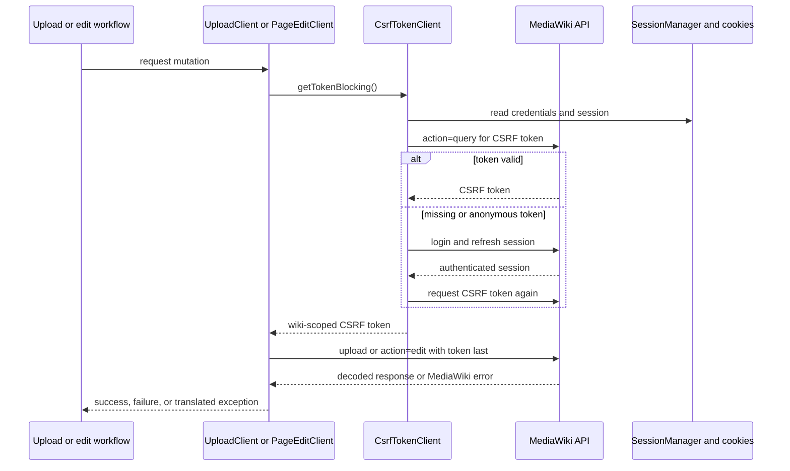
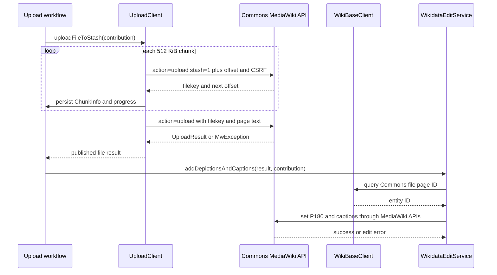

# MediaWiki and Wikidata integrations

The app treats Wikimedia services as two related but distinct MediaWiki installations. Commons owns media files, file pages, categories, reviews, and most user-facing edits; Wikidata owns structured entities and statements. Retrofit services are created by `CommonsServiceFactory` for the host selected by the build, while a separate `OkHttpJsonApiClient` handles JSON-only Toolforge, SPARQL, campaign, and file-usage endpoints.

## Endpoint matrix and ownership

| Surface | Production | Beta | Main callers and responsibility |
|---|---|---|---|
| Commons site/API | `https://commons.wikimedia.org` / `https://commons.wikimedia.org/w/api.php` | `https://commons.wikimedia.beta.wmflabs.org` / `https://commons.wikimedia.beta.wmflabs.org/w/api.php` | Login, CSRF, uploads, page edits, categories, media and file metadata |
| Wikidata site/API | `https://www.wikidata.org` / `https://www.wikidata.org/w/api.php` | The beta build still uses `https://www.wikidata.org` | Entity lookup and Wikidata mutations, including captions and claims |
| Commons file usage | `https://commons.wikimedia.org/w/api.php?action=query&format=json&formatversion=2` | The same production URL | `OkHttpJsonApiClient` adds `prop=fileusage` or `prop=globalusage`; this is intentionally not switched to beta |
| SPARQL | `https://query.wikidata.org/sparql` (provided as `WIKIDATA_SPARQL_QUERY_URL`) | Same configured service | Nearby places, depictions, subclasses, and other read-only queries |
| Wikimedia Forge | `https://tools.wmflabs.org/` | Same configured service | Leaderboards, upload/edit counts, avatars, and achievements; beta requests add `labs=commonswiki` where implemented |
| Campaigns | `https://raw.githubusercontent.com/commons-app/campaigns/master/campaigns.json` | `https://raw.githubusercontent.com/commons-app/campaigns/master/campaigns_beta_active.json` | Remote campaign configuration |

The build flavor is therefore significant: production writes to live Commons, whereas beta writes to the Commons beta wiki but continues to use live Wikidata and several shared read-only services. The concrete values are generated as `BuildConfig` fields in `app/build.gradle.kts`; `NetworkingModule` injects the selected values rather than scattering host selection through feature code.

## Network construction and session state

`NetworkingModule` creates named clients for each wiki from the same `CommonsServiceFactory`: Commons CSRF and login services, upload and page-edit services, category/media/review services, Wikidata CSRF and entity services, and separate `PageEditClient` instances for Commons and Wikidata. The Wikidata and Commons clients must not be interchanged: their base URLs, cookies, tokens, and API semantics belong to different wiki sessions.

A persistent `CommonsCookieStorage` is loaded from the default preferences store and wrapped in `CommonsCookieJar`. The shared OkHttp client uses 120-second connect, write, and read timeouts, an on-device cache, common headers, and body logging only for `BuildConfig.DEBUG` (basic logging otherwise). This makes cookies and request diagnostics part of the integration boundary, not feature-owned state.

### Authentication and CSRF invariant

Mutation calls require both the wiki's session cookie and a CSRF token from that same wiki. `CsrfTokenClient.getTokenBlocking()` requests `action=query` CSRF data off the main thread. If the response is empty or an authenticated session receives the anonymous token, it retries login (up to the client's configured retry limits), updates `SessionManager`, and retries token acquisition. Failure to obtain a non-anonymous token raises `InvalidLoginTokenException`; callers should surface this as an authentication/edit failure rather than issuing an unsafe mutation.

The Commons and Wikidata token clients are separately named (`NAMED_COMMONS_CSRF` and `NAMED_WIKI_CSRF`). Page edits pass the token as the final form field, and upload requests pass it as `token`. This ordering and host affinity are deliberate API requirements.

*This sequence shows the shared prerequisite for Commons and Wikidata mutations; the concrete Retrofit service is selected by the named host.*

## Commons uploads and page edits

`UploadClient` implements the two-stage MediaWiki upload contract:

1. It divides the local file into 512 KiB chunks and sends `action=upload&stash=1&ignorewarnings=1` as multipart data. Each request includes filename, total size, offset, prior `filekey`, the Commons CSRF token, and the chunk body.
2. It persists `ChunkInfo` through the contribution workflow so an upload can resume when the stash is still valid. A stash is considered valid for six hours; pause, cancellation, a missing contribution, or a failed chunk produces an explicit `PAUSED`, `CANCELLED`, or `FAILED` result.
3. Once all chunks have uploaded, it calls `action=upload&ignorewarnings=1` with the stash `filekey`, unique filename, generated page text, edit summary, and a fresh token. A response without an `upload` object is decoded as `MwException` and emitted as an error.
4. A successful publish returns an `UploadResult` and can trigger structured follow-up edits: `WikidataEditService.addDepictionsAndCaptions()` resolves the Commons file entity ID, then sets `P180 (depicts)` and captions sequentially. The follow-up is not implicit server-side atomicity: the file may exist even if Wikidata enrichment fails.

*This sequence separates resumable Commons publication from best-effort Wikidata enrichment.*

`PageEditInterface` supports replacement (`text`), creation with content model/format, append, prepend, and new-section edits. `PageEditClient` obtains the Commons or Wikidata token through its named `CsrfTokenClient` and maps the returned `Edit` response for the caller. The same interface also exposes Commons Wikibase captions and revision-content reads, so callers should choose the injected named client matching the target wiki.

## Wikidata reads and mutations

`DepictsClient` is the read-side adapter for Wikibase depictions. It searches using the user's locale, converts returned item IDs into `Entities`, and maps labels/descriptions with a locale-first, first-available fallback. If an entity has no description, it may resolve the first `P31 (instance of)` entity and use that entity's label as a description. `OkHttpJsonApiClient` converts SPARQL bindings to the same depiction model, while other nearby and browse features use SPARQL as a read-only query service.

`WikiBaseClient` wraps Commons Wikibase calls for file entities. It first obtains the Commons CSRF token, then translates `MwPostResponse.successVal == 1` into a Boolean; it can query a file page ID, read claim IDs by property, delete claims, replace the `P180` property, and add captions. `WikidataClient` is the distinct Wikidata-side writer: it obtains a token from the Wikidata interface, posts a serialized `StatementPartial`, attaches the `wikimedia-commons-app` tag, and returns `lastrevid`.

`WikidataEditService` deliberately orders multi-step mutations. Updating depictions reads existing claim IDs, deletes them, and only then adds the replacement values; a failed deletion does not proceed to addition. Adding image/caption claims uses the Wikidata item and `P18`, then reports the revision through `WikidataEditListener`. It skips image edits when `Picture_Has_Correct_Location` is false or when `P18` already exists. In beta, depiction writes substitute `Q10` for the selected values to avoid changing arbitrary live data.

## Categories, metadata, maps, and browser handoffs

Feature-specific Retrofit interfaces reuse the Commons base URL for categories, media details, file metadata, reviews, notifications, and page content. Direct JSON operations in `OkHttpJsonApiClient` translate non-successful responses, malformed bodies, and exceptions into nullable results or safe defaults depending on the operation: file-usage calls return `null`, count endpoints return `0`, and some malformed response objects become empty DTOs. Callers must therefore distinguish “no data/error fallback” from a confirmed empty Wikimedia result.

Nearby and map flows use Wikidata SPARQL queries through `OkHttpJsonApiClient`, while page creation/edit helpers use the injected Wikidata site URL for Wikidata item browser links. Browser handoffs build Commons or Wikidata `/wiki/` URLs from the corresponding configured site; they do not carry API tokens into the browser. The app can consequently show a public page or login flow without treating a browser navigation as an authenticated API operation.

## Safe change points and focused tests

* Add or change a host in the flavor-specific `buildConfigField` declarations first, then verify every `NetworkingModule` provider and any direct `BuildConfig` URL use. Do not silently point beta Wikidata services at the beta Commons host: the current beta contract keeps Wikidata production.
* Preserve the named separation of Commons and Wikidata CSRF/page-edit clients. A token fetched from one wiki is not a valid substitute for the other.
* Keep upload stash lifetime, offset/filekey progression, DAO persistence, and pause/cancel checks together when changing upload behavior. Test both a resumed valid stash and an expired or failed chunk.
* Treat publication and enrichment as separate failure domains; retrying Wikidata edits must not re-upload an already published file.
* `app/src/test/kotlin/fr/free/nrw/commons/actions/PageEditClientTest.kt` is the focused test surface for page-edit token/request/response behavior. CSRF retry and login behavior is similarly high-risk and should be covered at `CsrfTokenClient`'s visible-for-testing request boundary.

Related workflows: [Account and authentication](../workflows/account-and-authentication.md), [Media upload](../workflows/media-upload.md), [Nearby and location](../workflows/nearby-and-location.md), and [Review, delete, and edit](../workflows/review-delete-and-edit.md).
