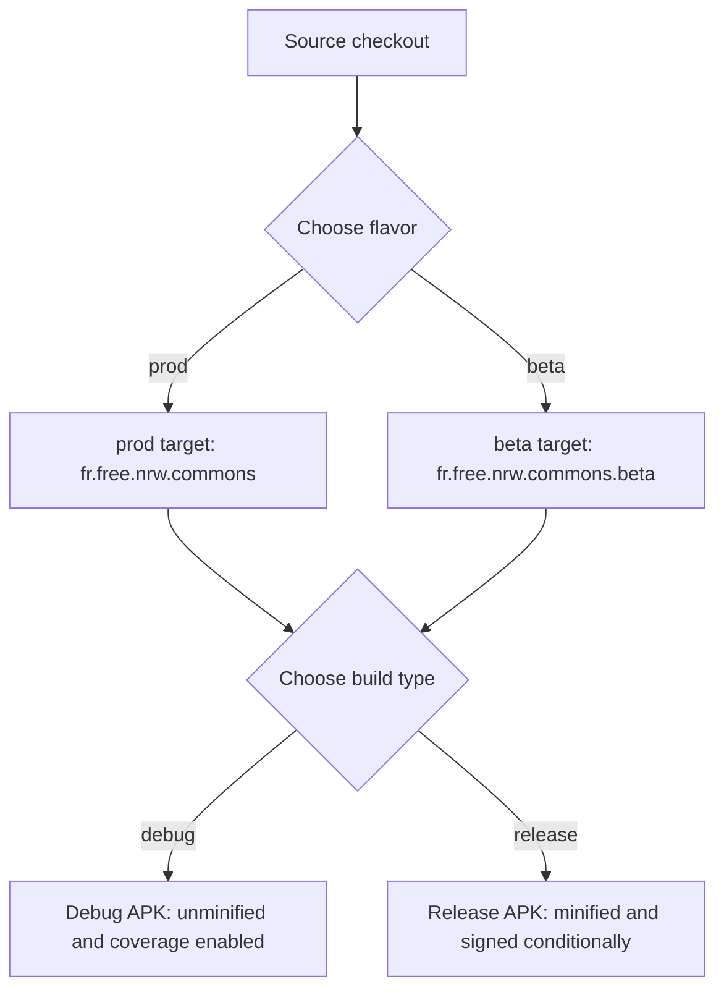
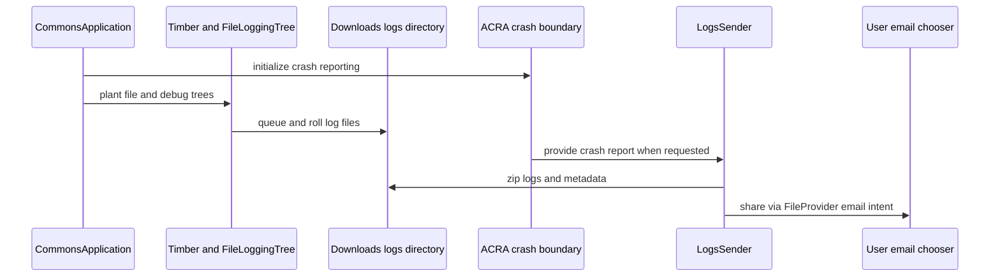

# Release, configuration, logging, and diagnostics

This page is the operational map for producing and investigating a Commons Android build. Treat **prod** and **beta** as different deployment targets, not merely different labels: a wrong flavor can send a release build to beta services or make a beta investigation look like a production incident.

## Build variants and service targets

The app has one `tier` flavor dimension and two product flavors:

| Variant | Application ID | Main service configuration |
| --- | --- | --- |
| `prod` | `fr.free.nrw.commons` | Wikimedia Commons production API and site, production upload image base, production campaigns, and production account/content-provider authorities |
| `beta` | `fr.free.nrw.commons.beta` | `commons.wikimedia.beta.wmflabs.org` API/site, beta upload image base, `campaigns_beta_active.json`, and beta account/content-provider authorities |

Both flavors use Wikidata production endpoints and the same Wikimedia Forge host. The beta flavor intentionally has a separate application ID so it can coexist with prod. The build also supplies flavor-specific Wikidata property IDs (`P180`/`P170` in prod and `P245962`/`P253075` in beta); do not infer a target from the APK filename alone—verify the variant and its generated `BuildConfig` values.



*The variant selection combines a service flavor with a debug or release build type.*

`debug` is unminified, appends `-debug-<branch>` to the version name, and enables unit-test and Android-test coverage. `release` enables R8/minification and uses the standard Android and project ProGuard rules. Locally, release is assigned the debug signing configuration; the CI signing configuration is selected only when CI is `true` and `../play.p12` exists. This means a locally generated “release” APK is not automatically a store-ready signed artifact.

Typical commands are:

```bash
./gradlew assembleBetaDebug
./gradlew assembleProdDebug
./gradlew assembleBetaRelease
./gradlew assembleProdRelease
```

The current default version is `versionCode = 1067` and `versionName = "6.8.0"`. `archivesBaseName` includes the version and the current Git branch; generated `COMMIT_SHA` fields use the short `git rev-parse --short HEAD` result (or a null value if Git lookup fails).

## Configuration and secret handling

`app/build.gradle.kts` reads `TEST_USER_NAME` and `TEST_USER_PASSWORD` from the root `local.properties` file and injects them into both flavors as `BuildConfig.TEST_USERNAME` and `BuildConfig.TEST_PASSWORD`. `local.properties` is machine-specific and explicitly must not be committed. Never paste its values into documentation, logs, tickets, APK metadata, or shell history.

CI creates `local.properties` at runtime from GitHub Actions secrets (`TEST_USER_NAME` and `TEST_USER_PASSWORD`) before analysis, tests, and APK assembly. The workflow does not print the values, but writing them to a workspace file still means the file must be treated as sensitive and not uploaded as an artifact. These are test credentials, not a substitute for production credentials.

Signing is similarly externalized. Automated non-PR CI uses environment variables `keystore_password`, `key_alias`, and `key_password`, reads `../nr-commons.keystore`, and can configure the Google Play publisher with `SERVICE_ACCOUNT_NAME` and `../play.p12`. Encrypted repository files such as `nr-commons.keystore.enc` and `play.p12.enc` are not usable signing inputs until the controlled release process supplies the decrypted files. Do not expose passwords, keystore contents, service-account material, or test credentials when diagnosing a build.

## CI checks and artifacts

The main Android workflow runs on pushes, pull requests, and manual dispatches. It uses JDK 17, then runs Kotlin formatting and Detekt, beta lint, and (on pull requests) `testBetaDebugUnitTestCoverage`; it assembles and uploads both debug APKs. The uploaded artifact names are `betaDebugAPK` and `prodDebugAPK`, with APKs under:

- `app/build/outputs/apk/beta/debug/app-*.apk`
- `app/build/outputs/apk/prod/debug/app-*.apk`

The separate manually dispatched beta workflow renames the APK to `apps-android-commons-betaDebug-<short-sha>.apk`, uploads it under a SHA-bearing artifact name, and retains it for 30 days. Instrumentation tests and unified coverage upload are present in `android.yml` only as commented-out steps; do not report them as current CI gates. Jacoco tasks do exist: for example, `testBetaDebugUnitTestCoverage` writes reports, while the unified task additionally expects Android-test execution data.

## Release gate

Before publishing, validate the target URLs and flavor in the final signed APK. The release checklist calls out `API_URL`, `IMAGE_URL_BASE`, `HOME_URL`, and `EVENTLOG_WIKI` as values that must point to Commons production; in the current Gradle configuration the corresponding endpoint values are flavor-generated rather than literal variables in `CommonsApplication.kt`. Also:

1. Check database schema changes and recursive `onUpgrade` migrations. Test migration from the immediately previous database version on the final signed APK; the checklist specifically suggests `adb install -r <apk>` for installing successive versions.
2. Increase the monotonically increasing `versionCode`, set the descriptive `versionName`, and keep the manifest/version and `CHANGELOG` updates together.
3. Create and push an appropriately named Git tag.
4. Upload the intended APK through the store console, update the store listing with the last two releases, publish the signed APK to the documented download location, and update the release history.
5. Monitor user feedback and remember that the security policy supports only the latest release. Vulnerabilities should be reported through the contacts in `SECURITY.md`, not through ordinary diagnostic attachments.

The checklist is partly a human release procedure: CI success does not prove that the correct flavor, migration path, signing identity, store listing, tag, or external distribution copy was used.

## Runtime logging and crash reports

At application startup, `CommonsApplication.onCreate()` initializes ACRA, injects dependencies, and plants two Timber trees: `FileLoggingTree` and Timber’s `DebugTree`. File logging is asynchronous on a single lowest-priority thread. The file tree accepts `VERBOSE` and higher messages, maps Android priorities to Logback levels, and rolls files at the configured 1000-KB threshold with indexes 1 through 4. Its active file is `<logDirectory>/<CommonsAppLogs|CommonsBetaAppLogs>.0.log`.

The directory is on public Downloads storage:

- prod: `Downloads/logs/prod`
- beta: `Downloads/logs/beta`

Zipped diagnostic output goes in the matching `.../zip` directory. Startup removes the flavor’s zip file when `File.totalSpace > 1000000`; this is a size-based cleanup check, not a complete retention policy. Logging can therefore fail or become unavailable because of storage, permissions, process termination, or asynchronous queue timing. A log bundle is evidence, not a guaranteed complete history.

ACRA is an interactive crash-report boundary, not a general telemetry pipeline. Its configured report contains the user comment, app version code/name, Android version, phone model, and stack trace, and its mail sender targets the private Commons Android group. The custom sender can combine the crash report, MediaWiki username, extra diagnostic data, and log files into a zip, then hand it to the user through an `ACTION_SEND` email chooser using a `FileProvider`. If no logs exist or zipping fails, no attachment URI is produced and the sender handles a silent exception. The UI explicitly warns that logs may contain identifying information; obtain consent and redact before sharing outside the intended support channel.



*The diagnostic path keeps local file logging, crash capture, and user-mediated sharing separate.*

## Safe diagnosis: production versus beta

Start with the APK’s variant, application ID, version name, and short commit SHA. Then compare the failing URL with the expected table above and inspect whether the report came from `Downloads/logs/prod` or `Downloads/logs/beta`. Reproduce against the same target before attributing a failure to shared code: beta Commons availability, beta campaigns, beta upload storage, and beta account state can fail independently of production.

For a production issue, do not “test” by changing a production build to beta endpoints. Build a separate `BetaDebug` artifact, preserve the production artifact, and label reports with flavor, build type, version, and commit. For a beta-only issue, first check beta service availability and test-account configuration; for an issue in both flavors, compare the shared code path and common Wikidata dependencies. Never diagnose from a crash attachment alone when the flavor or commit is missing.

As an optional documentation inspection step, run:

```bash
visualize openwiki --export docs/openwiki-visualizer
```

This inspects the generated OpenWiki documentation and is separate from Android release validation.

## Evidence map

- Build variants, endpoints, signing, versioning, and test-property loading: [`app/build.gradle.kts`](../../app/build.gradle.kts)
- CI checks and APK artifact paths: [`.github/workflows/android.yml`](../../.github/workflows/android.yml) and [`.github/workflows/build-beta.yml`](../../.github/workflows/build-beta.yml)
- Release gates: [`RELEASE-CHECKLIST.md`](../../RELEASE-CHECKLIST.md)
- Runtime startup, ACRA boundary, and Timber setup: [`CommonsApplication.kt`](../../app/src/main/java/fr/free/nrw/commons/CommonsApplication.kt)
- File rotation and asynchronous logging: [`FileLoggingTree.kt`](../../app/src/main/java/fr/free/nrw/commons/logging/FileLoggingTree.kt)
- Log locations and zipped sharing: [`LogUtils.kt`](../../app/src/main/java/fr/free/nrw/commons/logging/LogUtils.kt) and [`LogsSender.kt`](../../app/src/main/java/fr/free/nrw/commons/logging/LogsSender.kt)
- Supported-version and vulnerability policy: [`SECURITY.md`](../../SECURITY.md)
