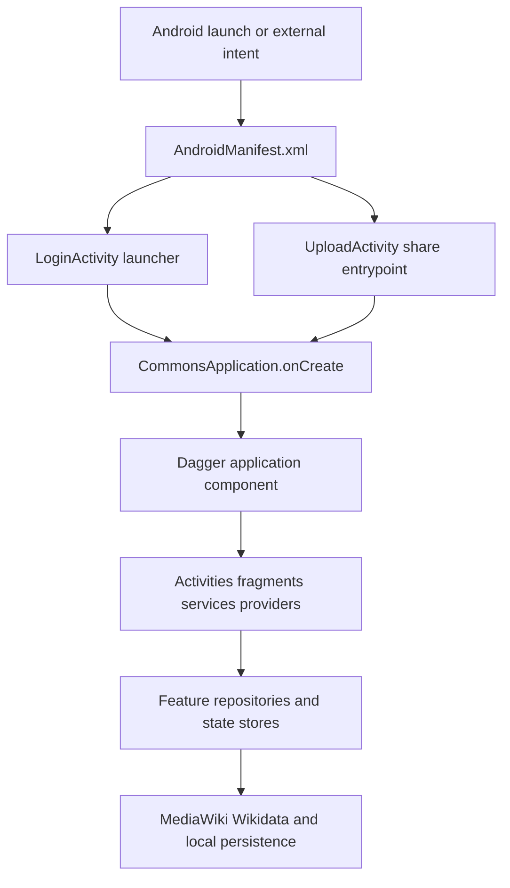

# Repository quickstart

This repository is the Wikimedia Commons Android app: users select or share media, prepare metadata, and upload it to Wikimedia Commons. Gradle includes one Android application module, `:app`; the root build configures shared plugins and test JVM arguments, while `settings.gradle.kts` owns repository resolution and module inclusion.

## Start with the source of truth

Treat production source and focused tests as authoritative. This page and the linked wiki guides are navigation aids, not substitutes for current code; generated artifacts, stale documentation, and ignored or unexecuted tests must not override what the implementation and the tests that actually run say. Begin at the manifest and the relevant feature owner, then follow its repository, worker, API adapter, or state store into tests.



*The main entrypoint and dependency path; inspect the manifest and the named source owner before changing behavior.*

`CommonsApplication` is a `MultiDexApplication`. During `onCreate()` it initializes ACRA, builds the singleton Dagger graph through `ApplicationlessInjection`, installs Timber logging, configures Fresco with the app HTTP fetcher, creates the notification channel, loads language data, and configures RxJava handling. `ApplicationlessInjection` supplies dispatching injectors for activities, both fragment APIs, services, broadcast receivers, and content providers. Dagger-backed activities inject before `super.onCreate()`, so new injectable Android components must use the corresponding base or injector path rather than constructing application dependencies directly. See [Application runtime and dependency graph](architecture/app-runtime.md).

The manifest is the authoritative Android component map. `LoginActivity` is the exported `MAIN`/`LAUNCHER`; `UploadActivity` is an exported `singleTask` target for `SEND` and `SEND_MULTIPLE` image or `audio/ogg` intents. The manifest also declares the account authenticator service, WorkManager foreground service, content providers for categories, recent searches, recent languages, and bookmarks, the location and review surfaces, and notification/location/media permissions. Follow the actual manifest and component code when adding an entrypoint.

## Task-routing map

| Task or change | Start here | Then follow |
|---|---|---|
| Startup, injection, navigation, or an Android component | [Application runtime and dependency graph](architecture/app-runtime.md) | `AndroidManifest.xml`, `CommonsApplication`, Dagger base classes |
| HTTP, cookies, CSRF, MediaWiki adapters, Room, or migrations | [Networking and local storage](architecture/networking-and-storage.md) | API services, `CommonsApplicationModule`, Room DAOs, legacy database helpers |
| Media, queues, bookmarks, categories, places, reviews, preferences, or lifecycle state | [Domain data, persistence, and lifecycle state](concepts/data-and-state.md) | owning DAO/repository and its focused tests |
| Commons, Wikidata, Forge, campaigns, maps, or browser handoffs | [MediaWiki and Wikidata integrations](integrations/mediawiki-and-wikidata.md) | flavor `BuildConfig` endpoints and integration adapters |
| Login, logout, AccountManager, challenge codes, cookies, or anonymous access | [Account and authentication flow](workflows/account-and-authentication.md) | `SessionManager`, authenticator service, CSRF client |
| Search, explore, categories, depictions, contributions, media details, or bookmarks | [Discovery, search, and contribution browsing](workflows/discovery-and-contributions.md) | screen presenter/view model, repository, paging and content provider |
| Picker/share input, metadata, queueing, retries, or upload failures | [Media selection, preparation, and upload lifecycle](workflows/media-upload.md) | `UploadActivity`, contribution persistence, `WorkRequestHelper`, `UploadWorker` |
| Location permission, nearby places, map markers, or selected coordinates | [Nearby places and location](workflows/nearby-and-location.md) | location manager, place repository, SPARQL/API boundary |
| Profile, settings, notifications, campaigns, quiz, or achievements | [Profile, settings, bookmarks, notifications, campaigns, and quiz](workflows/profile-settings-and-notifications.md) | preferences, workers, local stores, session state |
| Review, deletion nomination, captions, categories, thanks, or image editing | [Review, deletion, page edits, and image editing](workflows/review-delete-and-edit.md) | review queue, edit helpers, authorization and API response handling |
| Flavor, endpoint, signing, release artifact, logs, or crash diagnosis | [Release, configuration, logging, and diagnostics](operations/release-and-diagnostics.md) | `app/build.gradle.kts`, `BuildConfig`, CI and ACRA logs |
| Gradle build, unit/Robolectric tests, instrumentation, lint, ktlint, detekt, or coverage | [Build, test, and quality workflow](testing/build-and-quality.md) | [.github/workflows/android.yml](../.github/workflows/android.yml), task reports |
| Prod/beta matrix, debug/release behavior, credentials, or artifact naming | [Build flavors and configuration](testing/build-flavors-and-configuration.md) | `app/build.gradle.kts`, `local.properties`, signing environment |

## Build and validate locally

Use the checked-in wrapper and select the variant explicitly. Common starting points are:

```bash
./gradlew :app:assembleBetaDebug
./gradlew :app:assembleProdDebug
./gradlew :app:ktlintCheck :app:detekt
./gradlew :app:lintBetaDebug
./gradlew testBetaDebugUnitTest
./gradlew connectedBetaDebugAndroidTest
```

The exact task and whether a test is runnable depends on the current Gradle configuration; consult [Build, test, and quality workflow](testing/build-and-quality.md) rather than assuming every configured task runs in CI. The current Android CI uses JDK 17, writes `TEST_USER_NAME` and `TEST_USER_PASSWORD` from secrets into `local.properties`, runs ktlint, detekt, beta debug lint, PR unit coverage, and assembles/uploads both beta and prod debug APKs. Its instrumentation and non-PR unified-coverage blocks are commented out, so a green CI run does not prove those paths.

## Configuration and operational boundaries

`app/build.gradle.kts` defines `prod` and `beta` flavor dimensions, `debug` and `release` build types, the application IDs, endpoints, campaign URLs, test credentials, and artifact naming. Production points at Commons and Wikidata; beta uses the Commons beta host while retaining the Wikidata host. Debug builds are not minified and enable coverage; release builds are minified and normally use the debug signing config, switching to the release keystore only in the configured CI environment. Do not copy secrets into source or infer a production endpoint from a generated APK; use [Build flavors and configuration](testing/build-flavors-and-configuration.md).

The dependency module provides application context, API and persistence collaborators, content-provider clients, preferences, repositories, and schedulers. Local state crosses both Room and legacy SQLite/content-provider boundaries, so schema or logout changes need the data-and-state guide and the relevant migration/tests. Upload work is unique WorkManager work requiring a connected network and uses linear backoff; logout cancels that work before clearing session cookies, preferences, caches, and tables. These lifecycle and failure details belong in [Media selection, preparation, and upload lifecycle](workflows/media-upload.md) and [Domain data, persistence, and lifecycle state](concepts/data-and-state.md), not in a guessed entrypoint contract.

## A safe change loop

1. Identify the Android entrypoint or state owner in the manifest and production source.
2. Trace the boundary: UI to repository, repository to local store or API adapter, and asynchronous work to its worker and notification/error path.
3. Read the focused tests beside that owner; distinguish tests configured in Gradle from tests executed by CI.
4. Make the smallest change consistent with the existing flavor, threading, persistence, and authentication contracts.
5. Run the narrowest relevant unit or Robolectric tests first, then the matching lint/static-analysis and variant build. Use instrumentation only when an emulator-backed contract is involved.
6. For runtime issues, capture flavor, build type, commit SHA, logs, network/API response class, and persisted state before changing recovery behavior; see [Release, configuration, logging, and diagnostics](operations/release-and-diagnostics.md).
