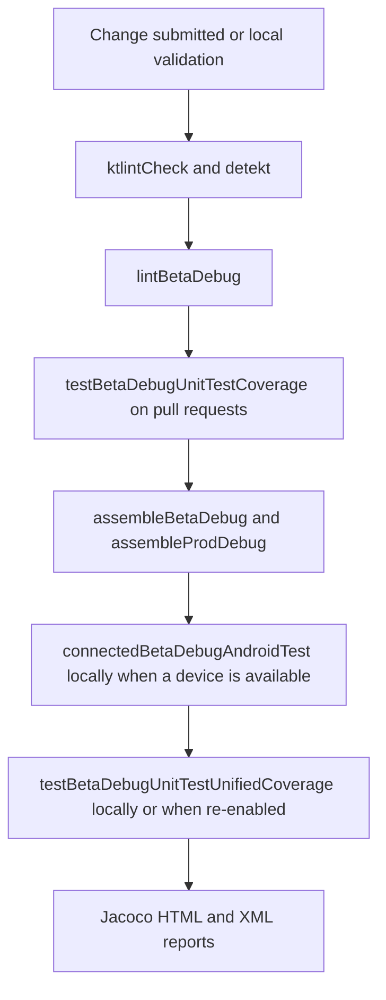

# Build, test, and quality workflow

This project is a single Android application module, `:app`, built with Gradle and Kotlin. The validation surface has four layers: compilation and APK assembly, JVM unit tests (including Robolectric), device/emulator instrumentation tests, and source-quality checks. A task being available from Gradle does not mean that CI runs it; use the workflow below as the execution contract.

## Build matrix and test configuration

`app/build.gradle.kts` declares the `prod` and `beta` product flavors and `debug` and `release` build types. The principal validation variants are therefore `betaDebug` and `prodDebug`. Debug builds enable both unit-test and Android-test coverage. Unit tests use `app/src/test/kotlin`, include the app's Android resources, return default values for otherwise-unmocked Android methods, and disable animations. The instrumentation runner is `androidx.test.runner.AndroidJUnitRunner`, with `clearPackageData=true` passed to it.

The beta flavor is the normal test target: it points at beta Wikimedia endpoints and supplies the test account values through `local.properties` (`TEST_USER_NAME` and `TEST_USER_PASSWORD`). The workflow writes those properties from repository secrets before Gradle runs. A local developer who needs login-dependent tests must provide equivalent properties; do not commit them.



*The diagram separates configured local/device tasks from the subset currently executed by the checked-in workflow.*

## What CI actually runs

`.github/workflows/android.yml` runs on pushes, pull requests, and manual dispatches. It uses Temurin JDK 17, caches Gradle packages, and then performs these active checks:

1. `./gradlew :app:ktlintCheck :app:detekt --continue --stacktrace`
2. `./gradlew :app:lintBetaDebug --stacktrace`
3. On pull requests, `./gradlew -Pcoverage testBetaDebugUnitTestCoverage --stacktrace`.
4. `bash ./gradlew assembleBetaDebug --stacktrace`, followed by upload of the beta APK artifact.
5. `bash ./gradlew assembleProdDebug --stacktrace`, followed by upload of the prod APK artifact.

The unit-test coverage step is conditional on `github.event_name == 'pull_request'`; it is not an all-event unit-test gate. The APK builds run after the quality checks and are active for all workflow events. Android lint is configured with `abortOnError = false` and disables `MissingTranslation` and `ExtraTranslation`, so a successful lint task is not equivalent to enforcing every lint finding.

The workflow does **not** currently execute device tests. The AVD setup and the `Run Instrumentation tests` step—including `./gradlew connectedBetaDebugAndroidTest --stacktrace`—are commented out. The `Run Unit tests with unified coverage` step and its Codecov upload are also commented out. Thus, the checked-in workflow currently produces beta unit-test coverage on pull requests, but no connected-test coverage or unified unit-plus-device report.

## Local Gradle task map

These are the exact useful entrypoints. They are configured by the Android, ktlint, detekt, and JaCoCo plugins and can be invoked locally even when their corresponding CI step is disabled.

| Purpose | Task or command | Execution boundary |
| --- | --- | --- |
| Format/style validation | `./gradlew :app:ktlintCheck` | Active in CI; legacy paths listed in `app/ktlint-legacy-files.txt` are excluded from ktlint. |
| Kotlin/static analysis | `./gradlew :app:detekt` | Active in CI; the app adds `app/detekt.yml` on top of Detekt's default configuration and uses `app/detekt-baseline.xml`. |
| Android lint | `./gradlew :app:lintBetaDebug` | Active in CI for beta debug only; local `lintProdDebug` is available for the other flavor. |
| All beta JVM tests | `./gradlew testBetaDebugUnitTest` | Local task; CI invokes its report-producing wrapper instead. |
| Pull-request unit coverage | `./gradlew -Pcoverage testBetaDebugUnitTestCoverage --stacktrace` | Active on pull requests. The task runs beta debug JVM tests and writes JaCoCo HTML/XML reports. |
| Connected beta instrumentation | `./gradlew connectedBetaDebugAndroidTest` | Local/device task; the equivalent CI emulator block is commented out. The build script disables device animations before the connected task. |
| Connected prod instrumentation | `./gradlew connectedProdDebugAndroidTest` | Local/device task; not used by the checked-in workflow. |
| Unified beta coverage | `./gradlew -Pcoverage testBetaDebugUnitTestUnifiedCoverage --stacktrace` | Locally available through `jacoco.gradle`; the workflow's non-PR invocation is commented out. |
| APK assembly | `./gradlew assembleBetaDebug` or `./gradlew assembleProdDebug` | Both are active CI gates and are also useful local smoke builds. |

`jacoco.gradle` creates a `*Coverage` report task depending on the corresponding unit-test task, and a `*UnifiedCoverage` task depending on both unit tests and `create*CoverageReport`. Unified reports combine the unit-test `.exec` file with connected Android-test `.ec` data. The report excludes generated Android/Dagger/Hilt code and broad model, database, data, and concurrency paths; coverage percentages therefore describe the configured class set, not every repository line.

## Test layers and focused starting points

### JVM unit tests and Robolectric

Use `testBetaDebugUnitTest` (or its coverage variant) for presenters, repositories, API clients, utility code, and database behavior that can be isolated from a live device. Robolectric is available as a test dependency, and representative Android-facing tests use `RobolectricTestRunner`; `MigrationTest` runs at SDK 21 and uses a `TestCommonsApplication`. It creates legacy data, forces the Room database to version 21, applies `MIGRATION_21_22`, and checks migrated categories, bookmarks, bookmark items, recent searches, and recent languages. For a schema or migration change, start with:

```sh
./gradlew testBetaDebugUnitTest --tests 'fr.free.nrw.commons.db.MigrationTest'
```

For upload business logic, prefer active focused tests such as `UploadClientTest`, `UploadControllerTest`, `UploadRepositoryUnitTest`, `UploadWorkerTest`, or the relevant media-processing test, then run the broader beta unit task. `UploadPresenterTest` contains several `@Ignore` cases, so those methods are regression notes rather than executable evidence.

### Instrumentation and UI tests

Use connected tests only when the behavior crosses Android framework, activity, permissions, Espresso, UiAutomator, or real device lifecycle boundaries. `LoginActivityTest` is a narrow UI surface: it checks forgot-password intent data, signup navigation, and an orientation change. It does not prove credential retention, login-button validation, or server authentication. `UploadCancelledTest` is a more representative upload/navigation boundary test and exercises the location-picker transition and cancellation path.

The `UploadTest` end-to-end upload scenarios are marked `@Ignore("Fix Failing Test")`; do not treat them as a passing upload gate. For a local focused run with an emulator/device, use the beta connected task and filter the class:

```sh
./gradlew connectedBetaDebugAndroidTest --tests 'fr.free.nrw.commons.LoginActivityTest'
./gradlew connectedBetaDebugAndroidTest --tests 'fr.free.nrw.commons.UploadCancelledTest'
```

If the Android Gradle Plugin version does not honor `--tests` for connected tasks in a particular environment, run the full `connectedBetaDebugAndroidTest` task and use the instrumentation runner's class filter instead. A connected run also depends on the app's `disableAnimations` task, which writes zero animation scales through `adb`.

## Recommended narrow validation by subsystem

- **Database, Room entities, or migrations:** run the focused migration/database tests under `fr.free.nrw.commons.db`, especially `MigrationTest`, then `testBetaDebugUnitTestCoverage` for the PR gate.
- **API clients, serialization, or networking:** run the relevant client test (`UploadClientTest`, `CategoryClientTest`, `MediaClientTest`, or `WikidataClientTest`) and its MockWebServer-based tests; add instrumentation only if activity or platform behavior is part of the change.
- **Upload preparation, metadata, workers, or presenters:** start with the narrow `upload` unit test matching the changed owner. Do not substitute ignored `UploadPresenterTest` cases or ignored `UploadTest` flows for active coverage. Use `UploadCancelledTest` when changing the device navigation/cancellation boundary.
- **Login and account UI:** run the account/authentication unit tests for logic, then `LoginActivityTest` on a device for intents and lifecycle behavior. A passing UI test does not validate remote authentication.
- **Compose or view UI changes:** run the nearest unit test where state can be isolated; use a connected UI test when semantics, rendering, intents, permissions, or configuration changes are the behavior under test.
- **Flavor/configuration changes:** run both `assembleBetaDebug` and `assembleProdDebug`, and run `lintProdDebug` in addition to the CI-only `lintBetaDebug` when the changed configuration is flavor-sensitive.
- **Broad pre-merge confidence:** run `:app:ktlintCheck`, `:app:detekt`, `:app:lintBetaDebug`, `testBetaDebugUnitTestCoverage`, and both debug APK assemblies. Add `connectedBetaDebugAndroidTest` locally for changes whose risk cannot be covered by JVM tests.

## Known quality gaps and failure interpretation

- CI does not currently run instrumentation tests, unified coverage, or Codecov upload because those workflow blocks are commented out.
- The active pull-request unit task is beta-only; prod-specific compilation is covered by APK assembly, not by a prod unit-test or prod lint gate.
- `UploadPresenterTest` and the upload instrumentation scenarios contain ignored tests. Existing test files are not proof that the behavior is executed or current.
- JaCoCo's configured exclusions remove generated code and several domain directories, including database/data/model areas. A high report must not be read as complete behavioral coverage.
- `release` is minified and normally debug-signed unless the Travis/play-publishing condition supplies release credentials. The ordinary Android CI workflow assembles debug APKs, so release shrinking/signing is outside these gates.

When a check fails, first identify its layer and variant: formatting/static analysis, beta lint, beta JVM/Robolectric, connected device, or flavor assembly. Reproduce the smallest task above, inspect the current production path, and only then broaden the run. Related state and persistence boundaries are documented in [Data and state](../concepts/data-and-state.md), release-facing diagnostics in [Release and diagnostics](../operations/release-and-diagnostics.md), and media flow test boundaries in [Media upload](../workflows/media-upload.md).
