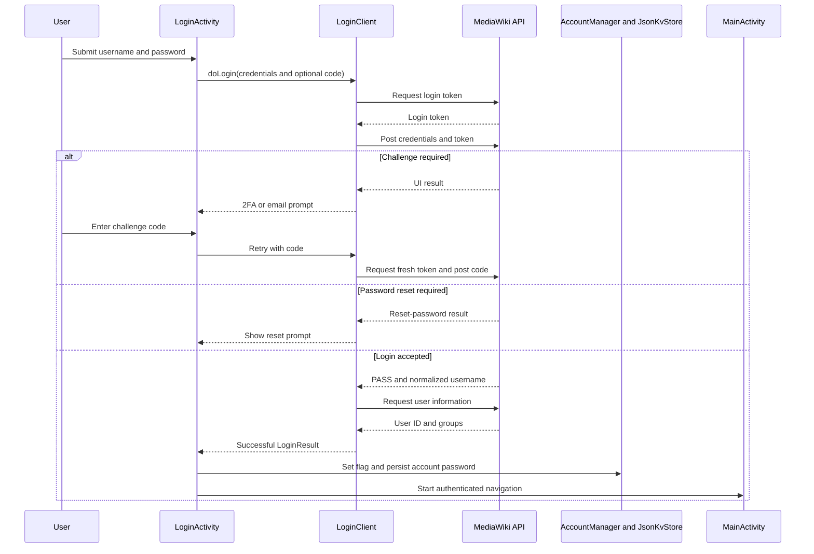

# Account and authentication flow

The app has two related but deliberately separate forms of session state:

- **Android account state** is owned by `SessionManager` and `AccountManager`. The account name is the MediaWiki username and the account password is stored as the Android account password.
- **Application login state** is the `isUserLoggedIn` Boolean in the default `JsonKvStore`. `login_skipped` is a separate preference controlling the anonymous onboarding/navigation path.
- **HTTP session state** is held by the persisted `CommonsCookieStorage`/cookie jar used by the MediaWiki and Wikidata clients. A cookie session is not itself proof that the app should expose authenticated UI: `LoginActivity.onResume()` requires both an account and `isUserLoggedIn`.

This separation is security-sensitive. A stale account, a logged-out cookie jar, and a false preference flag have different meanings and are not interchangeable.

## Interactive login and challenge handling

`LoginActivity` is both the normal login screen and the activity launched by Android's account-authenticator flow. It collects username, password, and (after a challenge) one code field. `performLogin()` passes those values, the device language, and the previous `LoginResult` to `LoginClient.doLogin()`.

`LoginClient` first obtains a MediaWiki login token, then posts the credentials and token. On the first attempt it sends the ordinary login form. If MediaWiki returns status `UI`, the result subtype determines the next UI action:

- `OAuthResult` causes `twoFactorPrompt`; the entered code is sent as `twoFactorCode` on the next attempt.
- `EmailAuthResult` causes `emailAuthPrompt`; the same UI field is sent as `emailAuthCode`.
- `ResetPasswordResult` stops the flow with a password-reset prompt rather than persisting the temporary-password login.
- Other failures, malformed responses, HTTP/transport failures, and failed user-information lookup reach the error callback.

A successful `PASS` response must include a username. The client then fetches extended user information (user ID and groups) before reporting success. Only then does `LoginActivity` set `isUserLoggedIn`, call `SessionManager.updateAccount()`, and enter `MainActivity`. Credentials are not documented or logged here; operators should provide them through the login UI or the Android account store, never by copying secrets into source or wiki content.

*The sequence shows token acquisition, challenge continuation, account persistence, and authenticated navigation; credentials and tokens are intentionally abstracted.*

The activity preserves username, password, challenge visibility, challenge type, error text, and progress-dialog state across configuration changes. Destroying the activity clears its disposables, dismisses the progress dialog, removes text watchers, and calls `LoginClient.cancel()`. `LoginClient` cancels outstanding token and login Retrofit calls; canceled callbacks return without showing a spurious error. This cancellation boundary matters when rotating or leaving the login screen.

## Account ownership and Android authenticator boundary

`SessionManager` is a singleton. It lazily selects the first account returned by `AccountManager.getAccountsByType(BuildConfig.ACCOUNT_TYPE)`, exposes its name and password, and creates or replaces the account when a successful login has a different username. The password is written with `AccountManager.setPassword`; it is not kept as a separate application preference.

`WikiAccountAuthenticatorService` binds Android's account-authenticator service to `WikiAccountAuthenticator`. For the configured `ACCOUNT_TYPE`, `addAccount()` returns an intent for `LoginActivity` carrying Android's `KEY_ACCOUNT_AUTHENTICATOR_RESPONSE`; unsupported account types receive a non-login placeholder bundle. The authenticator's `getAuthToken`, `confirmCredentials`, and `updateCredentials` implementations are placeholders, so this service is an account-entry integration, not a general-purpose Android token broker.

Account removal also cancels the configured contribution and modification sync authorities. The app-level logout path in `CommonsApplication.clearApplicationData()` cancels uploads, removes the Android account through `SessionManager.logout()`, clears the cookie jar and application data, resets preferences, and reports completion on the main thread. `LogoutClient` is narrower: it only clears cookie storage and is used by CSRF recovery. Neither operation should be described as revoking a MediaWiki password or as an OAuth token exchange.

## Cookies, CSRF, and recovery

Write operations obtain a MediaWiki CSRF token through `CsrfTokenClient`. The asynchronous path returns a valid token to its callback. If the request fails, or if an authenticated app receives MediaWiki's anonymous token (`+\\`), the client uses the stored account credentials to perform one recovery login after clearing cookies, then cancels and retries the token request. Missing credentials or an exhausted retry produces callback failure; two-factor and email prompts are forwarded instead of silently guessing a code.

The blocking path follows the same invariant with up to two login/token attempts. It reauthenticates on a retry, rejects login failures, empty tokens, and anonymous tokens with `InvalidLoginTokenException`, and never treats an empty token as success. Callers must handle that exception and must not proceed with a write using an anonymous or absent token. Retrofit callbacks also check `call.isCanceled` before reporting results.

## Skipped login and authenticated versus anonymous navigation

Choosing **Skip login** requires confirmation, sets `login_skipped` to `true`, starts `MainActivity`, and finishes `LoginActivity`. On resume, an already valid account plus `isUserLoggedIn` clears `login_skipped` and starts the main screen; otherwise a stored skip preference repeats the anonymous path. Logged-out screens use the preference and session flag to expose Explore/public browsing while gating contribution, upload, bookmark, notification, and other account-dependent actions. A prompt to log in is initiated through `SessionManager.forceLogin()` where a protected action needs credentials.

The skip flag is not an authentication grant. Code changing login, logout, or navigation must preserve the invariant that anonymous browsing can read public content but cannot be mistaken for an authenticated write session.

## Flavor configuration and operational boundaries

Build configuration supplies `ACCOUNT_TYPE`, wiki/API endpoints, password-reset URL, signup URL, and the beta/prod distinction. In the beta flavor, the login screen displays a beta credential/help string; production hides that label. Beta points at the beta Commons endpoints for login-related URLs, while production points at the production endpoints. These are configuration differences, not permission bypasses: beta credentials and test accounts must remain in protected build/test configuration and must never be copied into this page.

## Focused tests

`SessionManagerUnitTests` runs with Robolectric and exercises account discovery/creation, password access, login flag reads and writes, logout, preference lookup, and forced-login behavior. `CsrfTokenClientTest` uses the mock web server fixture to verify successful token delivery and failure propagation for API errors, HTTP failures, and malformed JSON. When changing this flow, add coverage for the relevant callback or state owner—especially challenge continuation, canceled calls, anonymous-token recovery, and the distinction between cookie clearing and full application logout.

Relevant source: [login activity](../../app/src/main/java/fr/free/nrw/commons/auth/LoginActivity.kt), [login client](../../app/src/main/java/fr/free/nrw/commons/auth/login/LoginClient.kt), [session manager](../../app/src/main/java/fr/free/nrw/commons/auth/SessionManager.kt), [CSRF client](../../app/src/main/java/fr/free/nrw/commons/auth/csrf/CsrfTokenClient.kt), and [application logout](../../app/src/main/java/fr/free/nrw/commons/CommonsApplication.kt).
