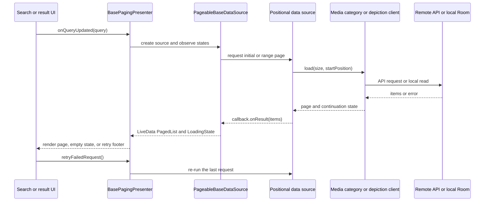

# Discovery, search, and contribution browsing

## Entry points and result boundaries

The app has deliberately different discovery datasets:

- **Media** is Commons image data. Free-text media search uses `MediaClient.getMediaListFromSearch`; category media uses `MediaClient.getMediaListFromCategory`; depiction media uses `WikidataMediaClient.fetchImagesForDepictedItem`.
- **Categories** are category names returned by `CategoryClient` (including parent, child, media, and search views). They are not media results; category clients apply their own filtering and continuation rules.
- **Depictions** are `DepictedItem` results from `DepictsClient.searchForDepictions`. Selecting one leads to the separate depiction-media flow.
- **Contributions** are a user's uploaded media represented as `Contribution`. The signed-in user's list is a Room-backed local list extended by a boundary callback; another user's profile uses a remote item-keyed data source instead.

Search opens `SearchActivity`, which keeps the three result tabs alive: media, categories, and depictions. A non-empty query is debounced for 500 ms, saved to recent-search storage, and forwarded only to active result fragments. An empty query hides the result pager and shows recent searches. Selecting a result can open `MediaDetailPagerFragment`; the activity retains the result fragments so returning from details preserves their scroll state.

## Paging, offsets, and continuation

The generic positional paging layer requests an initial load of 50 items and uses a page size of 50 with placeholders disabled. Each data source receives `(loadSize, startPosition)`, but the API strategy depends on the boundary:

- free-text media search passes both `loadSize` and `startPosition` to the search API;
- category media and user contributions use `MediaClient` continuation-key requests, so the client—not the positional offset—is the authority for the next server page;
- depiction search and depiction media pass the requested size and offset to their clients;
- category and depiction name searches are client-specific, even though their UI lifecycle is shared.

When a new query creates a paging source, the category-media source resets its category continuation at position 0. A contribution refresh resets the user continuation before fetching. Failing to reset when replacing the query can mix pages from two server cursors; changing a page size or query should therefore be reviewed together with the corresponding client continuation prefix.

This diagram shows the shared search/category/depiction paging path; contribution browsing has a separate Room boundary callback described below.

`PagingDataSource` emits `InitialLoad`, `Loading`, `Complete`, or `Error`. Exceptions are caught rather than delivered as a page. `BasePagingPresenter` translates initial errors into a snackbar and hides initial progress, while range errors expose a refresh footer; retry re-executes the last request. A successful zero-item result triggers the `noItemsLoadedEvent`, which the view turns into an empty message containing the query. A stale list is not silently treated as fresh: a query update creates a new factory, and callers must request a new query to restart its paging lifecycle.

## Recent searches are local state

`SearchActivity` persists a query on every non-empty debounced search. If the query already exists, its `lastSearched` timestamp is updated rather than inserting a duplicate. `RecentSearchesRoomDao` orders records by `last_used DESC` and supports lookup, replacement insert, and whole-table deletion; `RecentSearchesDao` exposes the same behavior through the recent-search content provider and limits the displayed list in application code. Clearing history deletes each stored item. Recent searches are local device state, not Commons results, and are not a cache of result pages.

## Contributions: two loading models

For the signed-in user's own contributions, `ContributionsRepository.fetchContributions()` exposes the Room `DataSource.Factory`. `ContributionBoundaryCallback` runs when the local list is empty and when the end is reached. It calls `MediaClient.getMediaListForUser`, maps every returned `Media` to a completed `Contribution`, saves the batch, and records `last_fetch_timestamp` after a successful save. A refresh resets the user's continuation first. If there is no signed-in username, the callback clears its subscriptions and does not fetch.

The callback's API failure invokes the refresh-finished callback and logs the error; it does not write a partial batch. Consequently, existing local rows remain observable on a failed refresh, while an empty local list remains empty and the UI must use its normal error/empty presentation. Dispose the callback with the owning screen or data-source lifecycle.

Other users' contribution lists use `ContributionsRemoteDataSource` directly. Its initial and after loads call the same user-media API and map the results to completed contributions; it has no Room boundary callback or local persistence. `loadBefore` is intentionally empty, so this is a forward-only history. Do not use the own-profile cache as the source of truth for another user's profile.

Pending, paused, and failed uploads are separate persisted contribution states and are owned by the upload workflow, not by the Commons contribution-history boundary. See [Media upload lifecycle](media-upload.md) when changing upload retry, deletion, or state transitions.

## Media details and onward actions

A media result opens the pager through a `MediaDetailProvider`, allowing the detail fragment to resolve the selected item and total count from its originating result list. The pager can bookmark or unbookmark the current image through `BookmarkPicturesDao`, copy/share its canonical Commons link, and open the author profile. Detail metadata also links category labels to `CategoryDetailsActivity` and depiction labels to `WikidataItemDetailsActivity`.

Media details are also a hand-off boundary. Editing captions/descriptions reads current wikitext and launches `DescriptionEditActivity`; location editing launches the location picker; upload/review-specific metadata and pending work belong to [Media upload lifecycle](media-upload.md). File-usage panels are independent requests: `MediaDetailViewModel` maintains separate Commons and global states (`Initial`, `Loading`, `Success`, `Error`), so one usage request can fail without making the other request appear successful.

## Focused verification

The most relevant tests are `PagingDataSourceTest` (initial/range success and failure, state emissions, and retry), `PagingDataSourceFactoryTest` and `BasePagingPresenterTest` (factory and UI lifecycle wiring), and `ContributionBoundaryCallbackTest` (empty/end boundaries, save mapping, and failed fetches). When changing recent-search persistence, also test the Room DAO/content-provider adapter and the query-empty transition in `SearchActivity`; when changing a continuation boundary, test both position-zero reset and subsequent-page behavior in the owning client.

## Safe change checklist

1. Identify whether the result is Commons media, a category, a depiction, or a contribution before changing its repository or client.
2. Trace the feature-specific `loadFunction` and its API continuation/offset contract, then trace `PageableBaseDataSource` and `BasePagingPresenter` for empty, stale, retry, and error behavior.
3. For own contributions, preserve the Room-first observation model and the boundary callback's reset-before-refresh ordering.
4. Keep recent searches and bookmarks local; neither is a server result cache.
5. Update the focused paging or boundary tests when changing page keys, continuation reset, or failure semantics.
