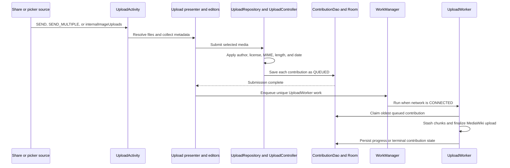
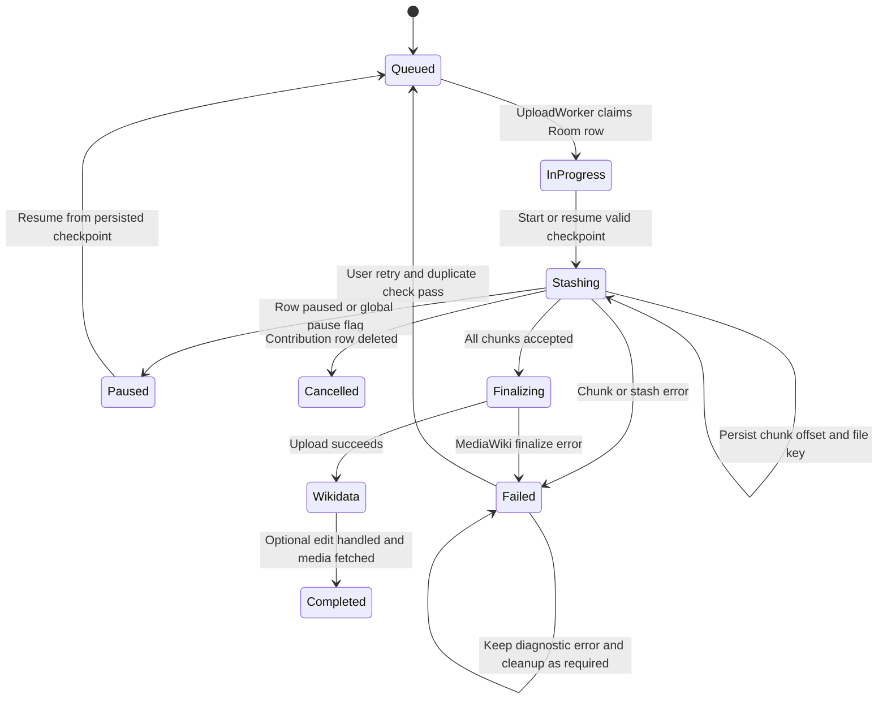

# Media selection, preparation, and upload lifecycle

The upload workflow has two ownership boundaries. `UploadActivity` and its presenter own the editable, pre-submit session; `ContributionDao` owns the durable queue after submission. `UploadWorker` does not depend on the activity remaining alive: it claims queued `Contribution` rows, performs remote work, and writes state, byte progress, and chunk checkpoints back to Room.

## 1. Input and editing

`UploadActivity` is an exported, `singleTask` activity. The manifest accepts `ACTION_SEND` and `ACTION_SEND_MULTIPLE` for `image/*` and `audio/ogg`. For an external share, temporary content-URI read permission is sufficient; the activity delegates URI/file normalization and filtering to `ContributionController.handleExternalImagesPicked`. In-app camera, gallery, and custom-selector flows use the internal `internalImageUploads` action and pass an `ArrayList<UploadableFile>` plus optional nearby `Place`, pre-capture location, and camera context.

The activity builds one media-detail editor per selected file, followed by shared categories/depictions and license steps. Editors collect filename, captions/descriptions, categories, location, depictions, and place information. `FileProcessor` reads image coordinates from EXIF or the supplied in-app location, redacts configured EXIF tags both in memory and on disk, and can prepopulate nearby categories and depictions. Nearby suggestions expand from 100 m to 1,000 m in 100 m steps and stop at the first result set containing at least five places.

Removing a file is still an editor operation. `UploadPresenter.deletePictureAtIndex` removes it from the in-memory repository and activity; removing the final file shows the cancellation message and finishes the activity. It does not cancel a contribution already persisted in the queue.

## 2. Preparation and durable queue creation

On submit, `UploadPresenter` first requires an authenticated session. It optionally warns after ten consecutive uploads without coordinates, then asks `UploadRepository` to build `Contribution` objects. Each contribution is prepared before persistence:

- `UploadController.prepareMedia` chooses the author (configured author name or the current account), applies the default license, supplies an empty fallback description, resolves MIME type, computes data length when possible, and derives an image creation date from `MediaStore` or the current time.
- Captions and descriptions are converted to Commons/Wikibase formats; selected depictions, categories, coordinates, `WikidataPlace`, local URI, content URI, and SHA-1 travel with the contribution.
- `Contribution.state` is set to `STATE_QUEUED` and the row is saved through the repository/`ContributionDao`. The Room row is the source of truth for pending work, including `transferred`, `chunkInfo`, `errorInfo`, retry count, and upload timestamps.

The presenter saves every built contribution before requesting work. A preparation/submission error shows failure, cleans up the transient repository, returns to the main activity, and does not start upload progress. On completion it requests unique WorkManager work and opens `UploadProgressActivity`. Limited-connection mode changes the user-facing “queued” versus “started” message; it does not remove WorkManager’s connected-network constraint.

*This sequence shows the hand-off from transient editing to the durable queue and background owner.*

## 3. WorkManager ownership and foreground notifications

`WorkRequestHelper` serializes enqueue attempts with an in-process lock and `isUploadWorkerRunning` guard. It creates a one-time `UploadWorker` request with `NetworkType.CONNECTED`, linear backoff, and the WorkManager minimum backoff delay. The request uses unique work named from `UploadWorker`; initial submission uses `ExistingWorkPolicy.APPEND_OR_REPLACE`, while retrying failed rows from the pending-upload UI uses `KEEP`.

The worker processes queued rows sequentially. It refuses to run its loop while another row is `STATE_IN_PROGRESS`, orders the snapshot of queued rows by upload-start time, sets the selected row to `STATE_IN_PROGRESS`, resets its displayed byte transfer to zero, and saves that claim before remote work. It loops until no queued rows remain. If new queued rows appear after the loop, it returns `Result.retry()` so WorkManager runs again; an uncaught worker exception returns `Result.failure()`. These WorkManager results are distinct from a contribution’s persisted `STATE_FAILED`: an individual upload failure is recorded and notified while the worker can continue through the queue.

The worker calls `setForeground` and uses the `dataSync` foreground-service type on Android Q and newer. It maintains a global “starting uploads” notification and a per-contribution ongoing notification. `NotificationUpdateProgressListener` updates the per-file percentage, cancels/replaces the prior notification, and synchronously writes `Contribution.transferred` to Room. Chunk completion separately writes `ChunkInfo`. Success makes the notification non-ongoing and opens the contribution list; failure/error notifications open the failed-upload tab; pause and cancellation have their own results.

## 4. Chunked stash upload and resume invariant

`UploadClient` divides the local file into **512 KiB (512 × 1024 byte)** chunks. Each stash request carries the filename, total file size, server offset, prior file key, CSRF token, and a counting request body. After a successful chunk, the client records the server `UploadResult` in `ChunkInfo(indexOfNextChunkToUpload, totalChunks)` and the worker persists it. `Contribution.isCompleted()` is true only when chunk information exists and the next-chunk index equals total chunks; transferred bytes alone do not prove completion.

A stash checkpoint is reusable only when its `dateModified` is within MediaWiki’s six-hour `wgUploadStashMaxAge` window. A valid checkpoint supplies the prior file key and offset, and already uploaded chunks are skipped. An expired or missing checkpoint starts chunking without that resume point. If a contribution row disappears during transfer, the client reports `CANCELLED`; it does not recreate the row.

The client checks the database state and the process-wide `CommonsApplication.isPaused` flag before each chunk. Pausing therefore stops future chunks, while an in-flight HTTP call may finish. The worker persists `STATE_PAUSED` for a paused result. `PendingUploadsPresenter.pauseUploads` changes queued and in-progress rows to paused; restart clears the global pause flag, requeues paused rows, and uses `KEEP` to request work. Deleting a pending row is cancellation by removal and is distinguishable from pausing.

*The state machine separates durable contribution states from the internal stash/finalization phases and makes pause, deletion, retry, and failure recovery explicit.*

## 5. Finalization, Wikidata, and completion

After stash success, the worker calls `findUniqueFileName`. If `File:<name>` already exists, it inserts a random five-digit suffix before the extension (or at the end for a name without an extension). It then submits the stash key with a CSRF token, generated page contents, and the default edit summary through `uploadFileFromStash`.

A successful MediaWiki response triggers depiction/caption edits through `WikidataEditService`. If a `WikidataPlace` is present and has valid location data, the worker creates a place image claim only when the place has no existing image, updates the local place image URL when a revision is created, and reports the result on the main thread. Invalid locations are reported without creating the claim. Wikidata exceptions are caught separately, so a media upload can still be completed even when the optional place edit fails or is skipped.

Completion fetches the uploaded `Media` by its `File:` title, replaces the queued row with the completed contribution through `deleteAndSaveContribution`, and asynchronously records original/modified SHA-1 status in `UploadedStatus`. Persistable content-URI permission is released after the successful path. The row’s completed state is therefore defined by the fetched server media, not merely by the last chunk.

## 6. Failure, retry, pause, and recovery rules

The result boundary matters:

- **Paused:** persists `STATE_PAUSED`, retains resumable chunk information, and shows a paused notification. Resume can continue from a valid stash checkpoint.
- **Cancelled:** deleting the contribution makes the client return `CANCELLED`; the row is not recreated. Editor cancellation before submission only finishes the editor.
- **Stash or finalize failure:** persists `STATE_FAILED`, error information where available, and shows a failed/error notification. General failure paths clear chunk information; specific stash error codes such as missing stash, verification, or chunk errors also clear it. A retry rechecks for duplicates, resets the upload timestamp, and requeues only when the duplicate check reports `IMAGE_OK`.
- **Invalid login token:** persists failure, notifies the user, and invokes `CommonsApplication.clearApplicationData`, which logs out and clears application data rather than repeatedly retrying with an invalid session.
- **Optional Wikidata failure:** is logged and reported to the UI but does not turn an otherwise successful media upload into a failed contribution.

Startup/application cleanup also calls `WorkRequestHelper.markUploadWorkerAsStopped`, allowing a later enqueue after a worker or logout boundary. Code changing queue transitions must update the DAO state filters, pending/failed UI, worker checks, and notification behavior together.

## Focused verification

- `UploadClientTest` verifies CSRF/page-finalization request fields, successful and error responses, the 512 KiB chunk-size contract, empty/failed chunk behavior, and resume success.
- `UploadWorkerTest` verifies unique filename preservation and five-digit collision suffixes.
- `UploadTest` is an end-to-end beta-oriented flow for descriptions, no description, multilingual descriptions, category selection, submit, and the expected Commons file URL; the scenarios are currently `@Ignore("Fix Failing Test")`, so they document intended coverage rather than a passing gate.
- When changing this workflow, also inspect `ContributionDao`, `PendingUploadsPresenter`, `UploadProgressActivity`, `ContributionController`, and authentication/CSRF recovery. The high-risk invariants are durable state ownership, one worker at a time, foreground notification updates, checkpoint age, and the distinction between retryable queue state and terminal failure.

Relevant source: [manifest](../../app/src/main/AndroidManifest.xml), [upload activity](../../app/src/main/java/fr/free/nrw/commons/upload/UploadActivity.kt), [file processor](../../app/src/main/java/fr/free/nrw/commons/upload/FileProcessor.kt), [presenter](../../app/src/main/java/fr/free/nrw/commons/upload/UploadPresenter.kt), [upload controller](../../app/src/main/java/fr/free/nrw/commons/upload/UploadController.kt), [upload client](../../app/src/main/java/fr/free/nrw/commons/upload/UploadClient.kt), [worker](../../app/src/main/java/fr/free/nrw/commons/upload/worker/UploadWorker.kt), [work request helper](../../app/src/main/java/fr/free/nrw/commons/upload/worker/WorkRequestHelper.kt), and [contribution model](../../app/src/main/java/fr/free/nrw/commons/contributions/Contribution.kt).
