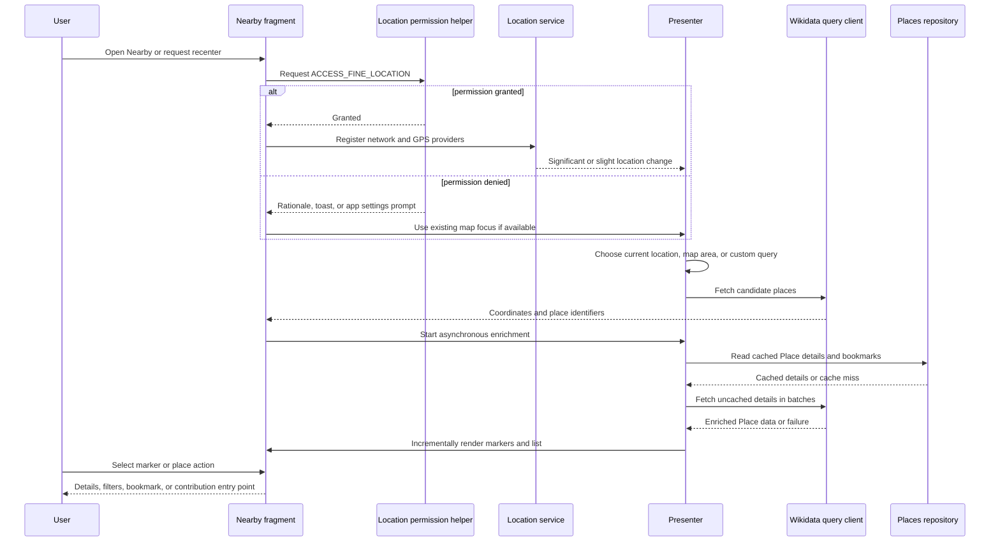
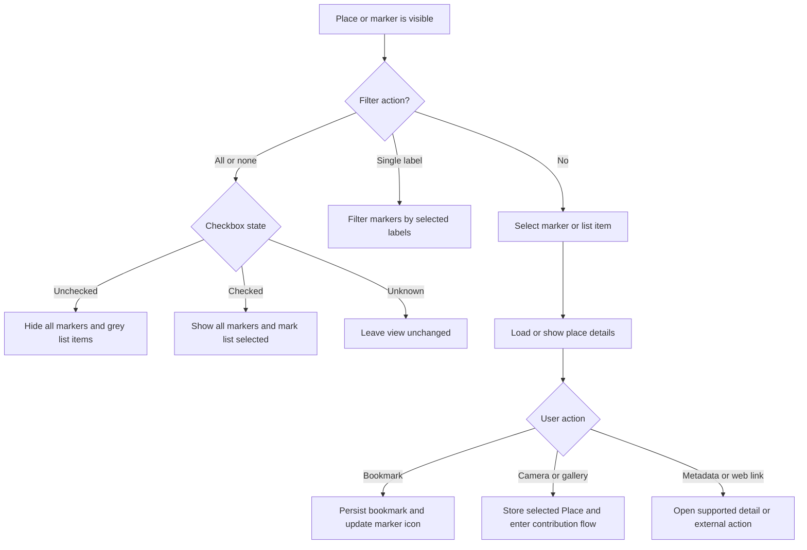

# Nearby places and location

Nearby is a read-oriented discovery surface: it finds Wikidata places that may need Commons photographs, renders them around a user or map area, and lets a person inspect, filter, bookmark, or use a place to begin a contribution. It is not the owner of the upload or metadata-edit transaction. Selected coordinates cross that boundary through the location picker and then enter the upload/media-edit workflow described in [Media upload](media-upload.md) and [MediaWiki and Wikidata](../integrations/mediawiki-and-wikidata.md). The broader state and persistence conventions are in [Data and state](../concepts/data-and-state.md).

## End-to-end control flow

*This sequence shows permission handling, location ownership, candidate querying, enrichment, and presentation; marker selection remains a Nearby action until a contribution workflow is explicitly started.*

## Permission, provider, and location lifecycle

`LocationPermissionsHelper` checks `ACCESS_FINE_LOCATION` before doing location-dependent work. On a first request it invokes the Android permission request. After a denial it can show a rationale and retry; repeated denial or “Don’t ask again” leads to an app-settings prompt rather than silently treating the device as located. The helper also distinguishes app permission from the device providers: if permission exists but network and GPS providers are both off, it offers the system location-settings screen. Declining that dialog still permits a caller to try its last known location, while showing the user why current location is unavailable.

`LocationServiceManager` owns provider registration and the last accepted `Location`. It requests updates from both `NETWORK_PROVIDER` and `GPS_PROVIDER`, tolerates missing providers and `SecurityException`, and unregisters them when the owner leaves. `getLastLocation()` first chooses the most accurate enabled-provider last-known fix and then reuses the cached fix. No fix is a valid state: Nearby must not manufacture coordinates and the presenter returns when neither map centre nor last map focus is available.

A candidate fix is accepted only when it is newer or more accurate under `isBetterLocation`. Accepted fixes are classified by distance: a change under 1 km is slight, while a change at or beyond 1 km is significant; a medium callback is also emitted for a 500 m-or-more movement in the callback path. Nearby uses significant changes to refresh places and slight changes primarily to move or track the user marker. `LatLng.from(Location)` preserves latitude, longitude, and accuracy; `LatLng` clamps latitude to `[-90, 90]` and normalizes longitude to `[-180, 180]`, so Android locations and map/query coordinates share one bounded representation.

## Refresh ownership and failure states

`NearbyParentFragmentPresenter.updateMapAndList` is the single refresh gate. It refuses overlapping work while Nearby is locked, refuses work without network connectivity, and refuses work without a usable map location. A significant location change or `MAP_UPDATED` requests the map centre; `SEARCH_CUSTOM_AREA` requests the map focus; `CUSTOM_QUERY` derives a location from the query when possible and falls back to the last focus. Slight changes do not trigger a new place query. An internal upload flag is consumed to skip one redundant refresh, preventing an upload-triggered edit from racing the read query.

The presenter locks the UI before a fetch, disables recentering, and shows progress. The fragment runs the blocking controller call off the main thread and unlocks on both empty-result and exception paths. Empty results show a “no nearby places” message; query failures show an error and restore controls. A successful Wikidata P18 edit can emit `MAP_UPDATED`, allowing a photographed place to disappear from the needs-photo result on the next read. Because locked refresh requests are dropped—not queued—new failure paths must always restore the unlocked state.

## Query parameters and coordinate conversion

There are two query shapes:

- **Radial nearby search.** The simple `radiusExpander` starts at 0.3 km and doubles the radius. The normal Nearby search stops after at least 20 results or at 300 km; the closest-place card stops after one result or 5 km. Results are later sorted by distance from the current point and limited to `NearbyController.MAX_RESULTS` (1000).
- **Visible map/custom search.** The map supplies osmdroid projection corners. The fragment converts top-right and bottom-left screen points to `LatLng`; legacy variable names are reversed in the population method, so the established argument ordering must not be “cleaned up” casually. For a small visible area, the client queries the rectangular bounds directly when the count is below the 1,500 upper threshold. For larger or denser areas it counts Wikidata items and binary-searches a radial radius targeting 1,000–1,500 items, capped by the map dimensions and 300 km. An advanced query replaces the default query and uses rectangular bounds; its search text may also provide a new location.

The controller passes the device/current location separately from the search location. That distinction matters: the search location controls which places are returned, while the current location supplies distance ordering and the map’s “around me” state. If the map has not produced real corners at startup, the fragment uses a small `0.009`-degree box around the search point rather than sending `(0, 0)` bounds.

## Enrichment, cache, and presentation

The initial Wikidata result is deliberately lightweight: it supplies an entity and location, not necessarily the complete display data. `updateMapMarkers` sorts by distance, caps the list, unlocks the refresh gate, and starts detail loading. The presenter first reads `Place` entities through `PlacesRepository`/`PlacesLocalDataSource`; a cached named place also restores bookmark state through `BookmarkLocationsDao`. Cache misses are split into batches of 10 and fetched concurrently with up to 20 coroutine workers through `NearbyController.getPlaces`. If a batch fails, its places are retried individually so one problematic Wikidata entity does not discard the entire batch; a still-failing place retains partial data.

Fetched places are saved asynchronously and merged without losing the candidate location, distance, monument flag, or bookmark changes made during loading. UI updates are scheduled on the main thread and may coalesce rapid updates, so the map can show location-only or grey markers before details arrive. Marker selection records the clicked place while details load, then fills the details sheet and saves the enriched place. A cache clear empties the Room-backed repository and deliberately causes visible markers to be re-enriched. Stale cache data can therefore be displayed temporarily, but a successful detail fetch replaces it.

### Filters and marker actions

*This branching describes the presenter’s filter semantics and the fragment’s marker-to-details actions.*

A single label filter delegates to `filterMarkersByLabels`. The tri-state all/none control overrides individual selections: unchecked hides all markers, checked restores all, and unknown performs no view operation. Marker details can update bookmark state, open Wikidata/Commons links, or store the selected `Place` in the key-value store for the contribution entry point. Those actions do not turn a Nearby read result into an upload by themselves.

## Location picker and metadata boundary

`LocationPicker.IntentBuilder` can carry an initial `CameraPosition`, an activity key, and optionally a `Media` object into `LocationPickerActivity`. The picker displays an osmdroid map and can recenter using the same permission/provider rules. When the user chooses a point:

- without a `Media`, it returns a `CameraPosition` containing the selected latitude, longitude, and a picker zoom value through `RESULT_OK`; the caller uses that position to continue an upload flow;
- with a `Media`, it calls `updateCoordinates`, which passes the selected latitude and longitude (and the picker’s `0.0f` accuracy) to `CoordinateEditHelper.makeCoordinatesEdit`; this is an edit of existing media metadata, not a Nearby marker update;
- when launched by `NoLocationUploadActivity`, it persists the selected centre and zoom as `LAST_LOCATION` and `LAST_ZOOM` so the next no-location picker can reopen there.

The picker’s `LocationPickerViewModel` exposes asynchronous `CameraPosition` responses through `MutableLiveData`; a null response is reported as null and transport failures are logged. If the user has no usable permission or provider fix, the map may remain at its supplied/default position and can still return a manually selected point. Removing an image location and opening coordinates in an external map are media-detail operations, separate from the nearby read query.

## Focused tests and safe extension points

`NearbyParentFragmentPresenterTest` covers the important presenter invariants: locking suppresses updates; no network or no location produces no fetch; significant and map-updated events populate the map; custom-area searches use map focus; slight changes only recenter when tracking is active; and filter tri-state behavior reaches the expected view operations. When changing thresholds, event routing, or lock behavior, update these tests and add failure-path coverage for every new asynchronous exit. When changing query geometry, test both rectangular small-area and radial dense-area paths, including null/empty results. When changing coordinate plumbing, test both picker result modes—no `Media` and existing `Media`—rather than assuming a selected map point is automatically upload metadata.
