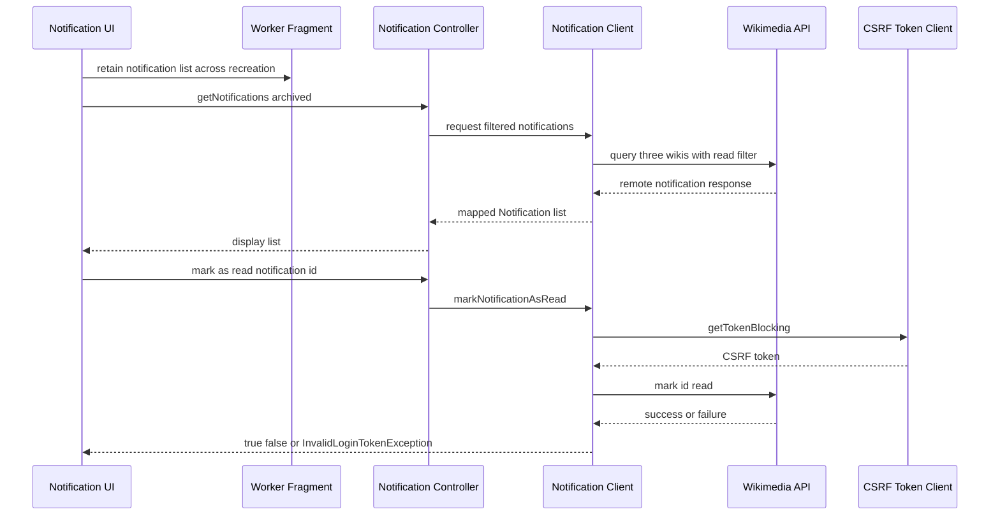

# Profile, settings, bookmarks, notifications, campaigns, and quiz

These surfaces are not one shared data store. Profile statistics, notifications, campaigns, and quiz inputs are fetched from remote services; settings are preference-scoped; and bookmarks are local persisted data. The `login_skipped` preference is the important logged-out boundary: the UI still exposes general features, but disables settings and tabs that require an account. For authentication lifecycle details, see [Account and authentication](account-and-authentication.md); for the broader state model, see [Data and state](../concepts/data-and-state.md).

## Profile: one container for three remote views

`ProfileActivity` receives a `username` intent extra and passes it to all three tabs: `AchievementsFragment`, `LeaderboardFragment`, and `ContributionsFragment`. It therefore supports the current user's profile and another user's profile rather than assuming that the session user is the displayed subject. The activity saves the username and contribution-tab flag across recreation. The profile screen also supports taking a screenshot and sharing it through the app `FileProvider`.

The tab contents are account-scoped by the requested username, but are not local caches:

- Achievements calls `OkHttpJsonApiClient.getAchievements(userName)` and separately retrieves the Wikidata edit count. A missing response or request failure leaves the statistics unavailable and offers a retry/snackbar path; beta builds hide the achievements content and show an unavailable message.
- Leaderboard uses remote data with duration and category filters and paged loading. Changing either spinner refreshes the view; the beta flavor skips the API work and reports that the feature is unavailable. The “my rank” action either scrolls within loaded rows or requests enough rows to include the rank.
- Contributions uses the username argument and its own remote contribution flow described in [Discovery and contributions](discovery-and-contributions.md).

Thus a logged-out user can open a profile for a supplied username, but the profile is not a substitute for an authenticated session and cannot make remote account data local.

## Settings: preference-scoped configuration

`SettingsActivity` is a host with an action-bar back affordance; `SettingsFragment` loads `R.xml.preferences` and wires behavior around those preferences. Preference values are app-local (Android preference storage and the injected `default_preferences` `JsonKvStore`), not Room records and not server configuration. `Prefs` centralizes stable keys for license, managed EXIF tags, account vanishing, description language, app UI language, and theme.

Important settings behavior:

| Setting area | Scope and behavior |
| --- | --- |
| UI language and default description language | Preference-scoped language choices. The selection flow remembers the chosen language and refreshes the main UI; the description-language control is account-dependent. |
| Theme | Preference-scoped; changing it recreates the activity. |
| EXIF tags | Preference-scoped multi-select. Removing the location tag records `has_user_manually_removed_location` in `default_preferences`. |
| Document-based photo picker | Preference-scoped. Turning it off displays a warning because some devices' `ACTION_GET_CONTENT` takeover can redact EXIF location metadata. |
| In-app camera location | Preference-scoped permission flow. Enabling it requests fine-location permission; denial can route through the rationale flow. |
| Account actions and campaigns | The account-vanishing action opens the configured web flow after confirmation; campaign preference and author/account controls require login. |
| Diagnostics and beta participation | Actions open the beta opt-in URL or request permissions before sending logs; these are local UI actions with remote/web boundaries, not profile data. |

When `default_preferences.login_skipped` is true, the fragment disables (rather than hides) external storage, author name, nearby-card and location-card settings, default description language, campaign preference, managed EXIF tags, document picker, in-app camera location, and account vanishing. General preferences remain available. This is a UI guard, not a claim that the user has an anonymous server account.

## Bookmarks: local persisted data with logged-out reduction

`BookmarksPagerAdapter` always creates Pictures and Categories pages. With `onlyPictures == false` it also creates Locations and Items pages; callers use `onlyPictures` for the logged-out case, so a logged-out user gets the pictures-only view. Bookmark navigation is fragment-based, and selecting a picture opens a media-detail pager; returning removes items marked for removal from the picture adapter.

Items are a local persisted store exposed through a content-provider client, rather than a remote API or a Room DAO in this feature. `BookmarkItemsController.loadFavoritesItems()` delegates to `BookmarkItemsDao`, which queries all rows and maps cursors to `DepictedItem`. Toggling an item first checks its id and then inserts or deletes it, returning the new favorite state. A provider `RemoteException` is wrapped as `RuntimeException`; there is no silent empty-list fallback for a provider failure (the controller only returns an empty list when its DAO reference is absent). Other bookmark types have their own local implementations, but the same product distinction applies: bookmarks are device-local and are not automatically account-synchronised.

## Notifications: remote Wikimedia data and retained worker state

`NotificationController` is a thin boundary over `NotificationClient`. The client requests Wikimedia notifications from `wikidatawiki|commonswiki|enwiki`; archived means the `read` filter and current notifications mean `!read`. The response is mapped to the app `Notification` model: missing headers and primary links become empty strings, dates are reduced to month-and-day text, and a header containing “Sent you an email” (case-insensitive) is classified as `EMAIL`; other types become `UNKNOWN`.

Marking a notification read obtains a Commons CSRF token and calls the API with the notification id. An `InvalidLoginTokenException` is propagated so the caller can force re-authentication; all other exceptions become `Observable.just(false)`. Fetch failures remain errors from the underlying reactive request and are handled by the activity/UI rather than being converted into fabricated notifications. `NotificationWorkerFragment` is a retained, configuration-change-safe holder for an in-flight/result `notificationList`; it is not a database cache.

*The diagram shows the documented notification request and mark-as-read boundaries; the retained fragment only preserves the list while the UI is recreated.*

## Campaigns: remote configuration, presenter-lifetime cache

`CampaignsPresenter` obtains the campaign response through `OkHttpJsonApiClient.getCampaigns()`, on the injected I/O scheduler and observes on the main scheduler. It sorts campaigns by parsed ISO short start date and selects the first campaign whose start date is at or before now and whose end date is at or after now. The selected campaign is cached in the singleton presenter: subsequent `getCampaigns()` calls immediately reuse it and do not hit the network. An empty response is reported to the view as `null`; a date parse failure produces no active campaign, while a request error is logged and does not show a campaign. Detaching the view disposes the request and clears the view reference. This is a presenter-lifetime cache, not persistent preference or Room state.

## Revert-rate quiz: account-scoped counters plus local checkpoints

`QuizChecker` uses the session username to fetch the remote upload count and achievements/deleted-upload count. It subtracts the last recorded upload and revert checkpoints from those totals in the `default_preferences` `JsonKvStore`, so the decision concerns activity since the previous quiz prompt. The current upload threshold is **5**, and the prompt condition is at least 50% reverted (`revertCount * 100 / totalUploadCount >= 50`) after both asynchronous requests have completed. A request failure is logged; negative deltas are clamped to zero and the corresponding stored checkpoint is reset.

If the condition holds, the checker displays a confirmation dialog. Accepting records the newly accounted upload and revert totals, then starts `WelcomeActivity` with `isQuiz=true`; cancelling does not start the quiz. `QuizController` supplies the five static quiz questions and their image URLs to the quiz flow. `QuizChecker.cleanup()` clears reactive subscriptions, so callers should invoke it with the owning activity lifecycle. The quiz itself is therefore remote/account-scoped in its trigger data but preference-scoped in its “already counted” checkpoints; it has no Room-backed state.

## Focused tests and safe extension points

The most useful regression tests are the component tests rather than screenshot tests:

- `NotificationClientTest` verifies the three-wiki/read-filter request, model mapping, and mark-read call; add coverage for invalid CSRF/login tokens and non-auth failures when changing fallback behavior.
- `CampaignsPresenterTest` covers empty responses, an active date window, presenter caching, and disposal on detach; date-boundary and malformed-date cases are important when changing campaign selection.
- `QuizCheckerUnitTest` exercises negative deltas, the threshold condition, cleanup, and launching the quiz; preserve the checkpoint semantics when changing thresholds or asynchronous orchestration.

When extending these surfaces, keep ownership explicit: remote APIs remain behind their client/presenter boundaries, preferences remain keyed through `Prefs` or the injected `JsonKvStore`, local bookmark persistence remains behind its DAO/content provider, and UI fragments should render failure states instead of manufacturing account data.
