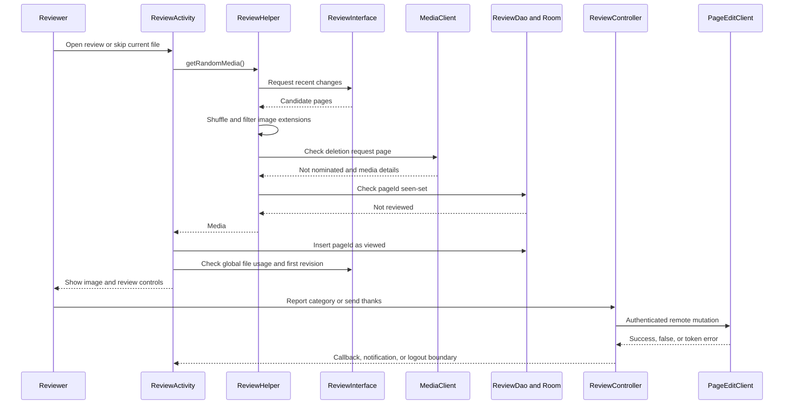
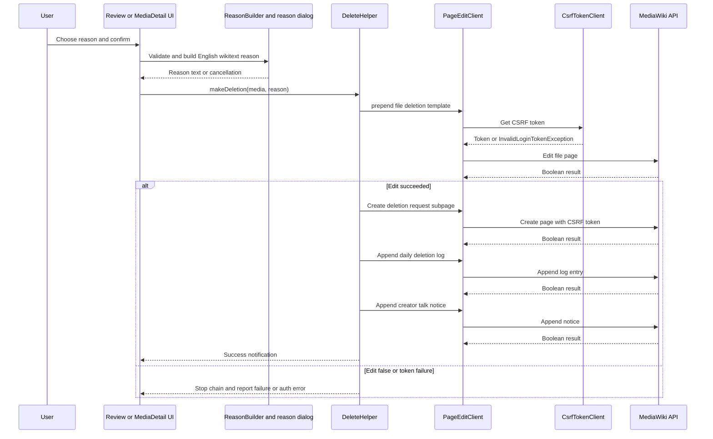

# Review, deletion, page edits, and image editing

This workflow crosses two different boundaries: **reviewed/skipped state is local Room state**, while thanks, category flags, captions, descriptions, and deletion nominations are remote MediaWiki mutations. The UI generally runs those remote operations on RxJava I/O schedulers and reports the result with a toast, notification, callback, or progress indicator. A CSRF/login-token failure is not treated as an ordinary false result: `PageEditClient` and `ThanksClient` rethrow `InvalidLoginTokenException`, allowing callers such as `ReviewController` to force logout or notify the review UI.

## Review queue and local lifecycle

`ReviewActivity` starts a review request through `ReviewHelper.getRandomMedia()`. The helper asks `ReviewInterface` for recent changes, shuffles the returned pages, and admits only titles ending in `.jpg`, `.jpeg`, or `.png`. For each candidate it checks `Commons:Deletion_requests/<title>` and rejects candidates that already have a deletion-request page before loading the `Media` record through `MediaClient`. It then filters out candidates whose `pageId` is already in the local `reviewed-images` table.

The local table is a seen-set, not a server-side review decision. When `ReviewActivity.updateImage()` receives a candidate it calls `addViewedImagesToDB(pageId)` immediately, before checking the filename, current user, usage, or category presentation. The same insertion is used for skipped images. `ReviewDao` uses `OnConflictStrategy.IGNORE`, so revisiting a page ID is harmless; `isReviewedAlready` is the gate used by subsequent selection. The insert is asynchronous and errors are logged, rather than surfaced as a blocking review failure.

Before showing a candidate, the activity checks global file usage. Files used on a wiki are skipped; unused files are displayed with their first revision and category visibility. A file uploaded by the current user is also skipped. The pager can omit the category step when all categories are hidden, because the activity treats that case as already handled by server-side bots. Activity recreation preserves the current `Media`, while the Room seen-set survives the activity.

*This sequence separates candidate selection and durable local “seen” state from the later remote review action.*

## Review actions, thanks, and category flags

`ReviewController` owns the action-level coordination. Spam and possible copyright violation open `DeleteHelper.askReasonAndExecute()` with a typed `DeleteReason`; the dialog callback disables the review buttons while the nomination runs and re-enables them on an error. Wrong-category review appends `\n{{subst:chc}}\n` to the file page through `PageEditClient.appendEdit()`, publishes an ongoing progress notification, and calls `onSuccess()` or `onFailure()` for a Boolean result. Its subscription error path logs with Timber but does not invoke a callback, so transport failures are not equivalent to a clean false response.

Thanks are tied to the first revision, not the current file title. `ReviewActivity` fetches that revision and stores it in the controller; `sendThanks()` then calls `ThanksClient.thank(revisionId)`. `ThanksClient` obtains a Commons CSRF token and posts the Wikimedia Thanks request with the app user agent. A normal false response becomes a failure toast. An `InvalidLoginTokenException` clears application data through the logout boundary; other exceptions are logged. If no first revision was loaded, the controller returns after showing the initial “send thanks” toast and makes no API call.

## Reason construction and deletion nomination

There are two reason-entry paths. The review dialog offers localized checkboxes for spam or copyright categories plus a required free-text note. The positive button is disabled until at least one checkbox and nonblank notes are present; selected labels are read from English resources so the wikitext is stable across UI locales. Cancellation calls the review failure callback and does not start a mutation. The media-detail deletion dialog similarly requires a reason, or maps a selected built-in reason to English text.

`ReasonBuilder` can append upload date and global file-usage count to a reason, and it redirects to login when no Android account exists. However, the current `MediaDetailFragment` calls `getReason()` and then ignores the value emitted by that call: both deletion paths pass the pre-built `reason`/`finalReason` into `DeleteHelper`. Thus the helper’s enrichment capability exists, but it is not currently reflected in the nomination text from this caller.

`DeleteHelper.delete()` performs a deliberately ordered four-page mutation:

1. `prependEdit()` adds a `{{delete|...}}` template to the file page, including reason, subpage, and current day/month/year.
2. `edit()` creates `Commons:Deletion_requests/<filename>` with a file heading, reason, and signature.
3. `appendEdit()` adds `{{Commons:Deletion requests/<filename>}}` to the date-based deletion log (`yyyy/MM/dd`).
4. `appendEdit()` adds `{{subst:idw|<filename>}}` to `User_Talk:<creator>`.

A false result raises `Failed to nominate for deletion` and stops the chain. Consequently, a later failure can leave earlier edits applied; this is not a transaction or rollback. A missing creator also fails before the chain starts. `makeDeletion()` turns completion into a deletion notification linking to the deletion-request page. The media-detail fragment records a temporary “nominating” flag, shows progress, updates the button and snackbar on success, and clears the flag on success or error. Token failures propagate separately from ordinary failures so the caller can take its authentication path.

*This request flow shows token acquisition per page-edit operation, ordered partial application, and the non-transactional failure boundary.*

## Authenticated page edits and metadata

`PageEditClient` is the common adapter over the MediaWiki edit interface. `edit()` replaces page content, `postCreate()` creates a wikitext page, `appendEdit()` and `prependEdit()` modify existing page text, and `createNewSection()` posts a new section. Each obtains a blocking CSRF token before calling the API. A successful API response is converted to `Boolean`; non-token exceptions are converted to `false` (or `0` for `setCaptions()`), while `InvalidLoginTokenException` is rethrown. `getCurrentWikiText()` is a read operation and returns the current revision content without performing an edit.

`DescriptionEditHelper` uses this adapter for file descriptions and for Wikibase captions. Description updates replace the supplied file-page text; caption updates call `setCaptions(summary, title, language, value)` and interpret response `1` as success. Both issue a notification linking back to the file and return a Boolean to their caller. Categories and structured depictions use their own helpers, but share the same authenticated UI boundary: `MediaDetailFragment` hides these controls for anonymous users, as well as hiding deletion and coordinate operations on the login-skipped path.

## In-app image editing

`EditActivity` accepts the input under the `image` intent extra and creates an `EditViewModel`. The view model owns one `Jpegtran` instance for the session and cleans it up from `onCleared()`. The activity provides rotate, crop, blur, and auto-blur controls:

- Rotation is animated in 90-degree increments for preview purposes. On apply or save, the pending relative rotation is committed through `Jpegtran`.
- Crop coordinates are mapped from the overlay to actual file dimensions, clamped to file bounds, and committed through lossless JPEG cropping.
- Blur maps selected overlay regions to image coordinates and saves a `blurred_<timestamp>.jpg` output. Auto-blur uses `CommonsVision` to detect regions, then places detections into the same overlay.

Rotate and crop outputs are new `cropped_<timestamp>.jpg` files; blur produces a separate `blurred_<timestamp>.jpg`. The source is not edited in place. Jpegtran exceptions are logged and rethrown by the view model; the activity catches operation errors, displays a mode-specific toast, and remains open. Save catches failures, shows the “failed to save image” toast, and does not finish. On success it returns `RESULT_OK` with the generated path in `editedImageFilePath` and finishes the activity.

The focused tests protect the boundaries that are easiest to regress: `DeleteHelperTest` verifies the four-call success path, each false-result stop, missing creator failure, and reason-dialog button validation; `ReviewControllerTest` verifies action delegation, progress/ordinary notifications, Thanks success behavior, and the no-first-revision guard.
